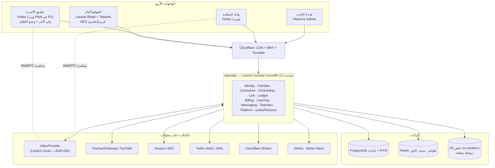

# البنية المعمارية

يجمع هذا الملف قرارات ADR-001 إلى ADR-012 في صورة واحدة. عند التعارض، الـ ADR هو المرجع.

## 1. الصورة العامة



الواجهات لا تتحدث مع قاعدة البيانات أو المزودين إلا عبر الخادم، باستثناء تدفق الفيديو المباشر (WebRTC) بين المتصفح ومزود الفيديو برمز دخول قصير العمر يصدره الخادم.

## 2. هيكل المستودع

```text
sura-academy/
├── apps/
│   ├── api/                 Laravel 13: REST API + Filament (/admin) + الموقع العام + المهام
│   ├── family/              Flutter: تطبيق الأسرة (ولي الأمر + وضع الطفل)، ويب في R1
│   └── teacher/             Flutter: بوابة المعلمة، ويب
├── packages/                حزم Dart (pub workspace في pubspec.yaml الجذري)
│   ├── sura_core/           أنواع مشتركة: النتيجة، الوقت، المال، مفاتيح الترجمة، الإعدادات
│   ├── sura_ui/             نظام التصميم: الألوان والخطوط والمكونات الاتجاهية + لقطات golden
│   ├── sura_arabic/         النص العربي: التطبيع الثلاثي، لوحة المفاتيح، الأرقام
│   ├── sura_api/            عميل مولَّد من OpenAPI + اعتراضات المصادقة (لا تعديل يدوي على المولَّد)
│   ├── sura_kids/           تجربة وضع الطفل (معزولة: بلا تحليلات، بوابة أبوية للروابط)
│   └── sura_classroom/      واجهة VideoClient + تنفيذ المزود + واجهة الفصل للطالب والمعلمة
├── contracts/openapi/       sura-api.v1.yaml + مكونات لكل وحدة
├── infra/
│   ├── docker/compose.yaml  postgres, redis, mailpit, minio, gotenberg, clamav
│   └── terraform/           envs/staging, envs/production على AWS eu-central-1
├── scripts/                 verify.sh, gen-api-client.sh, check-traceability.php, split-spec.php
├── specs/WP-x.y/            تصميم ومهام وملاحظات كل حزمة عمل (تُنشأ أثناء التنفيذ)
└── docs/                    الحوكمة، المواصفات، البنية، الخطة، الأدلة
```

`apps/kids` (تطبيق الطفل في المتاجر) لا يُنشأ في R1؛ إن تقرر لاحقاً (D-19) يكون غلافاً رقيقاً حول `sura_kids`.

## 3. الوحدات الاثنتا عشرة

كل وحدة في `apps/api/app/Modules/<Module>/` تملك جداولها، ولا تكتب في جداول وحدة أخرى. التواصل عبر واجهات `Contracts/` أو أحداث عبر جدول الصادر (outbox). اختبارات المعمارية (Pest arch) تفرض ذلك.

| الوحدة | المسؤولية | الجداول الرئيسية | تنشر أحداثاً | مخاطرة |
| --- | --- | --- | --- | --- |
| Identity | الحسابات، الدخول، التحقق الثنائي، الجلسات والأجهزة، رمز الطفل | users, auth_sessions, mfa_factors, student_pins, device_authorizations | UserRegistered, ChildDeviceAuthorized | متوسطة |
| Families | الأسر، أولياء الأمور، الطلاب، الموافقات، طلبات البيانات، العملاء المحتملون، بلاغات الحماية | families, guardians, students, student_profiles, legal_documents, consents, data_requests, leads, safeguarding_incidents | ChildAdded, ConsentGranted/Withdrawn | عالية (خصوصية) |
| Curriculum | المنهج والمحتوى والنتاجات، اختبار المستوى، المقابلات، التسكين، التجارب | programs, stages, levels, curriculum_units, lessons, lesson_plans, content_items, media_assets, learning_outcomes, placement_quizzes, assessments, placements, trials | PlacementAssigned, TrialBooked | متوسطة |
| Scheduling | الشعب، قواعد الجدول، التسجيل، الجلسات، العطل، التوفر، الإجازات، طلبات التغيير، قائمة الانتظار، البديلات | classes, class_schedule_rules, class_enrollments, enrollment_history, class_sessions, session_changes, calendar_exceptions, teacher_availability, teacher_leaves, change_requests, waitlist_entries, seat_holds | SessionScheduled, SessionRescheduled, SessionCancelled | **عالية** |
| Live | الغرف، رموز الدخول، أحداث المشاركين، التسجيلات | live_rooms, join_token_log, participant_events, recordings, recording_access_log | SessionStarted, SessionEnded, RecordingAvailable | **عالية** |
| Ledger | الحضور، طلبات الغياب، دفتر الرصيد، دفعات الرصيد، الاستثناءات | session_attendance, absence_requests, credit_ledger_entries, credit_lots, credit_balance_snapshots, attendance_exceptions | AttendanceConfirmed, CreditsLow, CreditsExhausted | **عالية** |
| Billing | الخطط، الأسعار، الخصومات، الاشتراكات، الدفع، الفواتير، الاسترداد، المحفظة | plans, prices, discount_rules, coupons, coupon_redemptions, subscriptions, subscription_events, payment_methods, payments, payment_allocations, invoices, invoice_lines, refunds, wallet_entries, settlements | PaymentSucceeded, PaymentFailed, SubscriptionStateChanged | **عالية** |
| Learning | الواجبات، التسليمات، التصحيح، التقارير ومراجعتها | assignments, submissions, submission_files, feedback, reports, report_items, report_reviews | ReportPublished, HomeworkAssigned | متوسطة |
| Messaging | محرك الإشعارات، القوالب، التفضيلات، سجل التسليم، الدعم، الإعلانات | message_templates, notifications, delivery_logs, notification_preferences, support_threads, messages, announcements | — (تستهلك) | متوسطة |
| Teachers | المعلمات، التأهيل، الوثائق، التدريب، الملاحظة، المستحقات | teachers, teacher_applications, teacher_documents, trainings, training_completions, observations, compensation_rules, compensation_lines, compensation_statements, payouts | TeacherActivated, StatementApproved | عالية (مال) |
| Platform | الإعدادات وإصداراتها، إصدارات القواعد، التدقيق، الملفات، أعلام الميزات، الصادر، أحداث التحليلات | settings, setting_versions, rule_versions, audit_logs, files, features (Pennant), outbox_events, webhook_calls | — | متوسطة |
| Jobs (بنية) | Horizon والجدولة | (Redis) | — | — |

الموقع العام ولوحة الإدارة واجهتان لا وحدتان: صفحات الموقع في `resources/views/site` وموارد Filament داخل كل وحدة في `Modules/<Module>/Filament`.

## 4. المصادقة والجلسات

| المستخدم | الواجهة | الآلية |
| --- | --- | --- |
| ولي الأمر | تطبيق الأسرة على الويب | Sanctum SPA: ملف ارتباط HttpOnly + CSRF (`/sanctum/csrf-cookie` ثم ترويسة `X-XSRF-TOKEN`)، الموقع والتطبيق والـ API تحت نطاق رئيسي واحد |
| ولي الأمر | التطبيق على الهاتف (لاحقاً) | رمز Sanctum شخصي مخزن في التخزين الآمن للجهاز |
| الطفل | وضع الطفل | رمز قصير العمر بنطاق `child:<student_id>` يصدر بعد رمز PIN على جهاز مفوّض؛ لا وصول لأي بيانات مالية أو اتصال |
| المعلمة والموظفون | بوابة المعلمة، لوحة الإدارة | Fortify + TOTP إلزامي؛ مهلة خمول 30 دقيقة للموظفين |

تفاصيل Flutter على الويب: Dio بمحوّل المتصفح مع `withCredentials: true`، واعتراض يقرأ `XSRF-TOKEN` ويضيف الترويسة.

## 5. الأحداث والمهام

- **الصادر (outbox):** كل حدث نطاق يُكتب في `outbox_events` داخل معاملة التغيير نفسها، ثم ينشره مُرسِل في الطابور. المستهلكون يفحصون معرّف الحدث لمنع المعالجة المزدوجة.
- **الوارد (webhooks):** `/webhooks/payments/{provider}` و`/webhooks/video/{provider}`: تحقق التوقيع، حفظ خام، رد خلال ثانيتين، معالجة في الطابور، عدم تكرار بمعرّف الحدث.
- **المهام المجدولة:** القائمة في `spec/15-api-webhooks-jobs.md`، كل مهمة في وحدتها، وكل مهمة قابلة لإعادة التشغيل دون أثر مزدوج.

## 6. البيئات

| البيئة | المكان | ملاحظات |
| --- | --- | --- |
| محلية | Docker Compose لخدمات البيانات + PHP وFlutter على الجهاز | بيانات تجريبية بأسر في المناطق الزمنية الثلاث عشرة |
| التجربة (staging) | AWS eu-central-1 (Terraform) | حسابات تجريبية لدى PayTabs ومزود الفيديو والبريد |
| الإنتاج | AWS eu-central-1 | بعد WP-5.7؛ النشر بعد موافقة يدوية |

## 7. تطبيقات Flutter

- **الحالة:** Riverpod (مع توليد الكود). **التوجيه:** go_router مع حراس للمصادقة ووضع الطفل.
- **الطبقات داخل كل ميزة:** `data/` (مستودع يلف العميل المولَّد) → `application/` (متحكمات Riverpod) → `presentation/` (الشاشات والمكونات).
- **الترجمة:** ARB عربي وإنجليزي عبر gen-l10n. العربية افتراضاً.
- **الويب (ADR-010):** بناء WebAssembly مع بديل JavaScript تلقائي، بدون موارد CDN (`--no-web-resources-cdn`)، خطوط مضمّنة، `fontFallbackBaseUrl` على نطاقنا، تفعيل شجرة إمكانية الوصول عند الإقلاع، شاشة افتتاحية HTML، Service Worker مخصص.
- **وضع الطفل:** حزمة `sura_kids` معزولة: لا تستورد أي حزمة تحليلات أو إعلانات، وكل رابط خارجي خلف بوابة أبوية.

## 8. المراقبة

Sentry في Laravel وFlutter مع تعطيل إرسال البيانات الشخصية (`send_default_pii=false`) وتنقية الحقول؛ معرّف طلب في كل استجابة وسجل؛ Better Stack للتوفر والسجلات. التنبيهات في `spec/19-infrastructure-devops-qa.md`.
