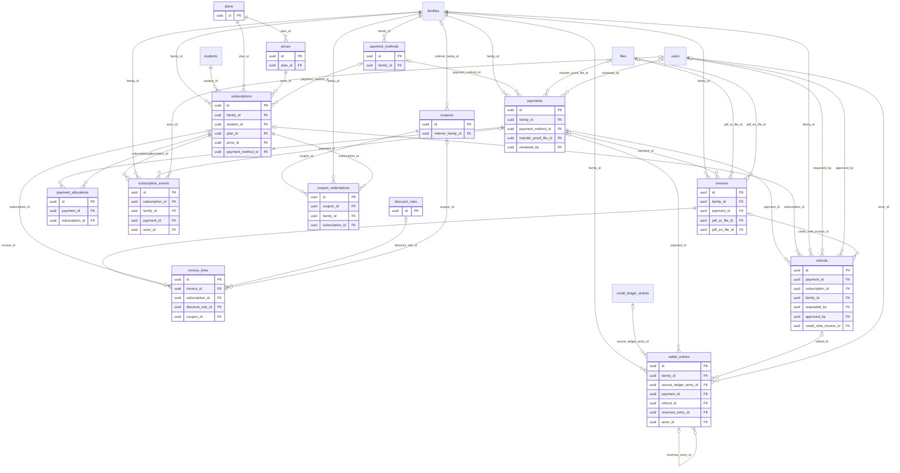

# ERD — Billing

الخطط والأسعار بتاريخها، والخصومات والقسائم، والاشتراكات بحالاتها التسع، ووسائل الدفع المحفوظة كرموز فقط، والدفعات وتوزيعها، والفواتير، والاسترداد، والمحفظة.

- **المال:** أعداد صحيحة بأصغر وحدة مع رمز العملة: الدولار بالسنت، والدينار بالفلس. الإطلاق بالدولار فقط (`billing.currency`).
- **الاشتراك:** اشتراك لكل طفل داخل سلة الأسرة (D-01). الطفل الأول هو صاحب أقدم اشتراك نشط، فإذا تساوى فالأعلى سعراً.
- **الدفع:** كل دفعة خلف واجهة `PaymentGateway` (ADR-006). حتى تكامل PayTabs يعمل الدفع ببوابة وهمية في الاختبار، وبالتحويل اليدوي في التجربة الميدانية (D-36). بيانات البطاقات لا تمر بخوادمنا.

<!-- erd:diagram:start -->

<!-- erd:diagram:end -->

### `plans`
- Kind: mutable · Spec: plans · Reqs: BIL-01, PUB-03, ONB-10 · Scope: none (catalogue)

| Column | Type | Null | References | Notes |
| --- | --- | --- | --- | --- |
| id | uuid | no | | PK (v7) |
| code | string | no | | |
| name_ar | string | no | | |
| name_en | string | no | | |
| sessions_per_cycle | smallint | no | | 8 by default (`subscription.sessions_per_cycle`, BR-002) |
| cycle_weeks | smallint | no | | 4 by default (`subscription.cycle_weeks`) |
| status | string | no | | values: active\|retired |
| created_by | uuid | yes | users.id | |
| updated_by | uuid | yes | users.id | |
| archived_at | timestamptz | yes | | |
| created_at | timestamptz | no | | |
| updated_at | timestamptz | no | | |

Constraints and indexes:
- `UNIQUE (code)`. A plan covers one student (D-01); siblings get their own subscriptions in the family basket.

### `prices`
- Kind: mutable · Spec: prices · Reqs: BIL-02, PUB-03 · Scope: none (catalogue)

| Column | Type | Null | References | Notes |
| --- | --- | --- | --- | --- |
| id | uuid | no | | PK (v7) |
| plan_id | uuid | no | plans.id | |
| amount_minor | bigint | no | | per student per cycle, e.g. 7200 cents |
| currency | char(3) | no | | |
| valid_from_at | timestamptz | no | | |
| valid_to_at | timestamptz | yes | | a new price applies to new subscriptions only (BIL-02) |
| created_by | uuid | yes | users.id | |
| updated_by | uuid | yes | users.id | |
| created_at | timestamptz | no | | |
| updated_at | timestamptz | no | | |

Constraints and indexes:
- No overlap per `(plan_id, currency)`: `EXCLUDE USING gist (plan_id WITH =, currency WITH =, tstzrange(valid_from_at, valid_to_at) WITH &&)`

### `discount_rules`
- Kind: mutable · Spec: discount_rules · Reqs: BIL-03, ONB-10 · Scope: none (catalogue)

| Column | Type | Null | References | Notes |
| --- | --- | --- | --- | --- |
| id | uuid | no | | PK (v7) |
| code | string | no | | |
| kind | string | no | | values: family_sibling (BIL-03) |
| percent_bps | integer | no | | from `billing.family_discount_pct` (12.5% = 1250) |
| applies_from_child_index | smallint | no | | 2: second child onward (D-01) |
| valid_from_at | timestamptz | no | | |
| valid_to_at | timestamptz | yes | | |
| created_by | uuid | yes | users.id | |
| updated_by | uuid | yes | users.id | |
| created_at | timestamptz | no | | |
| updated_at | timestamptz | no | | |

Constraints and indexes:
- `UNIQUE (code)`

### `coupons`
- Kind: mutable · Spec: coupons · Reqs: BIL-04, PUB-08, ONB-10 · Scope: none (catalogue)

| Column | Type | Null | References | Notes |
| --- | --- | --- | --- | --- |
| id | uuid | no | | PK (v7) |
| code | string | no | | |
| kind | string | no | | values: coupon\|referral (BIL-04 «رموز الإحالة»; rewards are R2, PAR-18) |
| discount_type | string | no | | values: percent\|fixed |
| percent_bps | integer | yes | | |
| amount_minor | bigint | yes | | |
| currency | char(3) | yes | | with `amount_minor` |
| max_redemptions | integer | yes | | |
| first_cycle_only | boolean | no | | BIL-04 «الشهر الأول فقط» |
| expires_at | timestamptz | yes | | |
| referrer_family_id | uuid | yes | families.id | owner of a referral code |
| status | string | no | | values: active\|disabled |
| created_by | uuid | yes | users.id | |
| updated_by | uuid | yes | users.id | |
| created_at | timestamptz | no | | |
| updated_at | timestamptz | no | | |

Constraints and indexes:
- `UNIQUE (code)`, `CHECK ((discount_type = 'percent') = (percent_bps IS NOT NULL))`, `CHECK ((amount_minor IS NULL) = (currency IS NULL))`

### `payment_methods`
- Kind: mutable · Spec: payment_methods · Reqs: BIL-05, BIL-07, ONB-09, PAR-08 · Scope: family_id

| Column | Type | Null | References | Notes |
| --- | --- | --- | --- | --- |
| id | uuid | no | | PK (v7) |
| family_id | uuid | no | families.id | |
| provider | string | no | | values: paytabs\|fake (ADR-006; fake gateway until WP-2.5, D-36) |
| provider_token_ref | string | no | | PII; gateway token for renewals; no card data is stored (S10:4) |
| wallet_type | string | no | | values: card\|apple_pay\|google_pay (BIL-05) |
| brand | string | yes | | |
| last4 | char(4) | yes | | PII |
| exp_month | smallint | yes | | |
| exp_year | smallint | yes | | |
| fingerprint | string | yes | | PII; card fingerprint for duplicate-trial review at first payment (D-09) |
| is_default | boolean | no | | |
| revoked_at | timestamptz | yes | | |
| created_at | timestamptz | no | | |
| updated_at | timestamptz | no | | |

Constraints and indexes:
- `UNIQUE (provider, provider_token_ref)`, `INDEX (fingerprint)`, `UNIQUE (family_id) WHERE is_default AND revoked_at IS NULL`

### `subscriptions`
- Kind: mutable · Spec: subscriptions · Reqs: BIL-06, BIL-07, BIL-08, BIL-14, PAR-07, PAR-09, ONB-10, ADM-01 · Scope: family_id

| Column | Type | Null | References | Notes |
| --- | --- | --- | --- | --- |
| id | uuid | no | | PK (v7) |
| family_id | uuid | no | families.id | |
| student_id | uuid | no | students.id | one subscription per child (D-01) |
| plan_id | uuid | no | plans.id | |
| price_id | uuid | no | prices.id | price at subscription time (BIL-02) |
| status | string | no | | values: draft\|pending_payment\|active\|grace\|suspended\|paused\|completed\|cancelled\|refunded (state-machines.md S1–S11) |
| started_at | timestamptz | yes | | first actual session, not payment (spec/14) |
| auto_renew | boolean | no | | can be switched off (BIL-07) |
| renew_trigger_balance | smallint | no | | `subscription.renew_trigger_balance` (2) at creation |
| payment_method_id | uuid | yes | payment_methods.id | saved token used for renewal |
| renewal_reminded_at | timestamptz | yes | | D-07 reminder |
| renewal_not_before_at | timestamptz | yes | | reminder + 72 h (D-07) |
| grace_ends_at | timestamptz | yes | | `billing.grace_period_days` after a failed renewal (S6) |
| suspended_at | timestamptz | yes | | S8 |
| paused_until_at | timestamptz | yes | | spec `paused_until`; freeze per D-27 |
| cancelled_at | timestamptz | yes | | |
| cancel_reason | text | yes | | |
| created_by | uuid | yes | users.id | |
| updated_by | uuid | yes | users.id | |
| created_at | timestamptz | no | | |
| updated_at | timestamptz | no | | |

Constraints and indexes:
- `UNIQUE (student_id) WHERE status IN ('pending_payment','active','grace','suspended','paused')`: one live subscription per child
- `INDEX (family_id, status)`, `INDEX (status, grace_ends_at)`
- Every status change writes `subscription_events` in the same transaction (spec/14).

### `payments`
- Kind: mutable · Spec: payments · Reqs: BIL-05, BIL-08, BIL-09, BIL-15, BIL-16, PAR-08, ADM-08 · Scope: family_id

| Column | Type | Null | References | Notes |
| --- | --- | --- | --- | --- |
| id | uuid | no | | PK (v7) |
| family_id | uuid | no | families.id | |
| amount_minor | bigint | no | | |
| currency | char(3) | no | | |
| method | string | no | | values: card\|wallet\|manual_transfer (BIL-05, BIL-09) |
| provider | string | no | | values: paytabs\|fake\|manual |
| provider_ref | string | yes | | unique per provider (spec/14) |
| purpose | string | no | | values: initial\|renewal\|late_payment (proposed) |
| attempt_no | smallint | no | | dunning attempt on days `billing.dunning_retry_days` (BIL-08) |
| status | string | no | | values: initiated\|succeeded\|failed\|refunded_partially\|refunded (state-machines.md) |
| idempotency_key | string | no | | Art. 10 |
| payment_method_id | uuid | yes | payment_methods.id | |
| three_ds_result | string | yes | | BIL-05 |
| failure_code | string | yes | | |
| transfer_proof_file_id | uuid | yes | files.id | manual transfer proof (BIL-09, PAR-08) |
| reviewed_by | uuid | yes | users.id | finance approves a manual transfer (BIL-09, ADM-08) |
| reviewed_at | timestamptz | yes | | |
| succeeded_at | timestamptz | yes | | |
| failed_at | timestamptz | yes | | |
| created_at | timestamptz | no | | |
| updated_at | timestamptz | no | | |

Constraints and indexes:
- `UNIQUE (idempotency_key)`, `UNIQUE (provider, provider_ref) WHERE provider_ref IS NOT NULL` (no double processing)
- `INDEX (family_id, created_at)`, `INDEX (status)`

### `payment_allocations`
- Kind: mutable · Spec: payment_allocations · Reqs: BIL-10 · Scope: family_id (via payment)

| Column | Type | Null | References | Notes |
| --- | --- | --- | --- | --- |
| id | uuid | no | | PK (v7) |
| payment_id | uuid | no | payments.id | |
| subscription_id | uuid | no | subscriptions.id | same family only (BIL-10) |
| amount_minor | bigint | no | | |
| currency | char(3) | no | | equals the payment currency |
| created_at | timestamptz | no | | |
| updated_at | timestamptz | no | | |

Constraints and indexes:
- `UNIQUE (payment_id, subscription_id)`; the sum per payment equals `payments.amount_minor` (checked in the action).

### `subscription_events`
- Kind: append-only · Spec: subscription_events · Reqs: BIL-06, BIL-08, BIL-14, PAR-09 · Scope: family_id

| Column | Type | Null | References | Notes |
| --- | --- | --- | --- | --- |
| id | uuid | no | | PK (v7) |
| subscription_id | uuid | no | subscriptions.id | |
| family_id | uuid | no | families.id | |
| event | string | no | | values: PlanSelected\|PaymentSucceeded\|Freeze\|Resume\|CreditsExhausted\|RenewalPaymentFailed\|PaymentCollected\|GraceExpired\|LatePaymentSucceeded\|Cancel\|RefundApproved\|RenewalToggled (state-machines.md; `RenewalToggled` for BIL-07 auto-renew on/off) |
| from_status | string | yes | | values: draft\|pending_payment\|active\|grace\|suspended\|paused\|completed\|cancelled\|refunded |
| to_status | string | yes | | values: draft\|pending_payment\|active\|grace\|suspended\|paused\|completed\|cancelled\|refunded; null when the status does not change (`RenewalToggled`) |
| payment_id | uuid | yes | payments.id | |
| metadata | jsonb | yes | | e.g. freeze length; D-27 limits are read from these rows |
| reason | text | yes | | |
| actor_type | string | no | | values: user\|system |
| actor_id | uuid | yes | users.id | |
| occurred_at | timestamptz | no | | |
| created_at | timestamptz | no | | |

Constraints and indexes:
- `INDEX (subscription_id, occurred_at)`

### `coupon_redemptions`
- Kind: mutable · Spec: coupon_redemptions · Reqs: BIL-04 · Scope: family_id

| Column | Type | Null | References | Notes |
| --- | --- | --- | --- | --- |
| id | uuid | no | | PK (v7) |
| coupon_id | uuid | no | coupons.id | |
| family_id | uuid | no | families.id | |
| subscription_id | uuid | no | subscriptions.id | |
| discount_minor | bigint | no | | |
| currency | char(3) | no | | |
| redeemed_at | timestamptz | no | | |
| created_at | timestamptz | no | | |
| updated_at | timestamptz | no | | |

Constraints and indexes:
- `UNIQUE (coupon_id, subscription_id)`, `INDEX (coupon_id)` (usage limit)

### `invoices`
- Kind: mutable · Spec: invoices · Reqs: BIL-11, PAR-08, ADM-08 · Scope: family_id

| Column | Type | Null | References | Notes |
| --- | --- | --- | --- | --- |
| id | uuid | no | | PK (v7) |
| family_id | uuid | no | families.id | |
| number | string | no | | sequential, never reused; the series format is WP-2.4's (BIL-11) |
| kind | string | no | | values: invoice\|credit_note (refund credit note, state-machines.md S11) |
| payment_id | uuid | yes | payments.id | |
| currency | char(3) | no | | |
| subtotal_minor | bigint | no | | |
| discount_minor | bigint | no | | |
| tax_minor | bigint | no | | 0 until taxes apply (BIL-18 is R2) |
| total_minor | bigint | no | | |
| issued_at | timestamptz | no | | |
| issuer_snapshot | jsonb | no | | legal-entity details at issue time |
| customer_snapshot | jsonb | no | | PII; billed guardian name and country at issue time |
| pdf_ar_file_id | uuid | yes | files.id | Arabic and English PDFs (BIL-11) |
| pdf_en_file_id | uuid | yes | files.id | |
| created_at | timestamptz | no | | |
| updated_at | timestamptz | no | | |

Constraints and indexes:
- `UNIQUE (number)`, `INDEX (family_id, issued_at)`
- Immutable once issued (corrections are credit notes); kept per Jordanian accounting law in a restricted archive (F17:47).

### `invoice_lines`
- Kind: mutable · Spec: invoice_lines · Reqs: BIL-11, BIL-03, BIL-04 · Scope: family_id (via invoice)

| Column | Type | Null | References | Notes |
| --- | --- | --- | --- | --- |
| id | uuid | no | | PK (v7) |
| invoice_id | uuid | no | invoices.id | |
| subscription_id | uuid | yes | subscriptions.id | |
| description_ar | string | no | | no child name on the line |
| description_en | string | no | | |
| quantity | integer | no | | |
| unit_amount_minor | bigint | no | | |
| discount_rule_id | uuid | yes | discount_rules.id | family discount applied (D-01) |
| coupon_id | uuid | yes | coupons.id | |
| discount_minor | bigint | no | | |
| tax_minor | bigint | no | | |
| amount_minor | bigint | no | | |
| currency | char(3) | no | | |
| created_at | timestamptz | no | | |
| updated_at | timestamptz | no | | |

Constraints and indexes:
- `INDEX (invoice_id)`

### `refunds`
- Kind: mutable · Spec: refunds · Reqs: BIL-12, PAR-09, ADM-08 · Scope: family_id

| Column | Type | Null | References | Notes |
| --- | --- | --- | --- | --- |
| id | uuid | no | | PK (v7) |
| payment_id | uuid | no | payments.id | |
| subscription_id | uuid | yes | subscriptions.id | |
| family_id | uuid | no | families.id | |
| amount_minor | bigint | no | | |
| currency | char(3) | no | | |
| kind | string | no | | values: full\|partial |
| channel | string | no | | values: gateway\|manual\|wallet (BIL-12) |
| reason_code | string | no | | values: unused_new_subscription\|withdrawal_period\|academy_fault\|other (S10:31-34) |
| market | char(2) | no | | family market when requested (BIL-12) |
| status | string | no | | values: requested\|approved\|rejected\|executed (state-machines.md) |
| idempotency_key | string | no | | Art. 10 |
| provider_ref | string | yes | | |
| requested_by | uuid | yes | users.id | |
| approved_by | uuid | yes | users.id | finance (RBAC table) |
| approved_at | timestamptz | yes | | |
| executed_at | timestamptz | yes | | |
| credit_note_invoice_id | uuid | yes | invoices.id | |
| created_at | timestamptz | no | | |
| updated_at | timestamptz | no | | |

Constraints and indexes:
- `UNIQUE (idempotency_key)`, `UNIQUE (provider_ref) WHERE provider_ref IS NOT NULL`, `INDEX (status)`

### `wallet_entries`
- Kind: append-only · Spec: wallet_entries · Reqs: BIL-13, BIL-12 · Scope: family_id

| Column | Type | Null | References | Notes |
| --- | --- | --- | --- | --- |
| id | uuid | no | | PK (v7) |
| family_id | uuid | no | families.id | |
| type | string | no | | values: CONVERSION_CREDIT\|PAYMENT_USE\|REFUND_CREDIT\|EXPIRY\|REVERSAL (proposed) |
| amount_minor | bigint | no | | signed; balance = sum per family and currency |
| currency | char(3) | no | | USD (BIL-13) |
| source_ledger_entry_id | uuid | yes | credit_ledger_entries.id | the `CONVERSION_TO_WALLET` entry: remaining sessions × `credit_lots.unit_price_minor` (D-28) |
| payment_id | uuid | yes | payments.id | wallet used on a payment |
| refund_id | uuid | yes | refunds.id | academy-fault refund taken as wallet credit |
| reverses_entry_id | uuid | yes | wallet_entries.id | |
| expires_at | timestamptz | yes | | cancellation approval + `billing.wallet_freeze_months` (3) |
| idempotency_key | string | no | | |
| actor_type | string | no | | values: user\|system |
| actor_id | uuid | yes | users.id | |
| reason | text | yes | | |
| created_at | timestamptz | no | | |

Constraints and indexes:
- `UNIQUE (idempotency_key)`, `UNIQUE (reverses_entry_id)`, `UNIQUE (source_ledger_entry_id) WHERE source_ledger_entry_id IS NOT NULL`, `INDEX (family_id, created_at)`
- Trigger `forbid_mutation`; corrections are `REVERSAL` rows.
