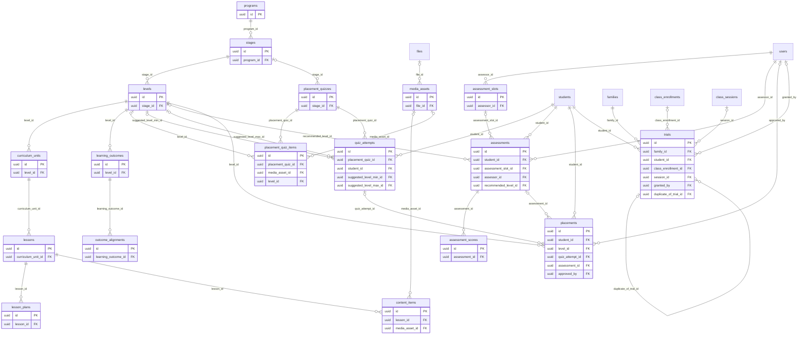

# ERD — Curriculum

المنهج بتسلسله (برنامج ← مرحلة ← مستوى ← وحدة دراسية ← درس ← عنصر محتوى، CNT-01)، وخطط الدروس، والوسائط، وكتالوج نتاجات التعلم (الأساس البياني من CR-002 وفق D-26، دون واجهة). وفيها التقييم: اختبار المستوى، والمقابلة الشفوية ودرجاتها، وقرار التسكين، والتجارب.

المحتوى التعليمي نفسه بالعربية الفصحى (D-18، `variety = msa`)، ويُحفظ كما كُتب بتشكيله كاملاً. البحث يستخدم فهرساً مطبّعاً منفصلاً بلا تشكيل (13:28). أعمدة `_ar`/`_en` للعناوين القصيرة التي تظهر في الواجهات فقط.

<!-- erd:diagram:start -->

<!-- erd:diagram:end -->

### `programs`
- Kind: mutable · Spec: programs · Reqs: CNT-01, PUB-02 · Scope: none (catalogue)

| Column | Type | Null | References | Notes |
| --- | --- | --- | --- | --- |
| id | uuid | no | | PK (v7) |
| code | string | no | | |
| name_ar | string | no | | |
| name_en | string | no | | |
| summary_ar | text | yes | | public program page (PUB-02) |
| summary_en | text | yes | | |
| sort_order | smallint | no | | |
| published_at | timestamptz | yes | | visible on the public site |
| created_by | uuid | yes | users.id | |
| updated_by | uuid | yes | users.id | |
| archived_at | timestamptz | yes | | |
| created_at | timestamptz | no | | |
| updated_at | timestamptz | no | | |

Constraints and indexes:
- `UNIQUE (code)`

### `stages`
- Kind: mutable · Spec: stages · Reqs: CNT-01, PUB-02 · Scope: none (catalogue)

| Column | Type | Null | References | Notes |
| --- | --- | --- | --- | --- |
| id | uuid | no | | PK (v7) |
| program_id | uuid | no | programs.id | |
| code | string | no | | |
| name_ar | string | no | | |
| name_en | string | no | | |
| age_min | smallint | no | | ages shown on stage pages (PUB-02) |
| age_max | smallint | no | | |
| sort_order | smallint | no | | |
| created_by | uuid | yes | users.id | |
| updated_by | uuid | yes | users.id | |
| archived_at | timestamptz | yes | | |
| created_at | timestamptz | no | | |
| updated_at | timestamptz | no | | |

Constraints and indexes:
- `UNIQUE (program_id, code)`, `CHECK (age_min <= age_max)`

### `levels`
- Kind: mutable · Spec: levels · Reqs: CNT-01, CNT-09, PUB-02, ASM-03 · Scope: none (catalogue)

| Column | Type | Null | References | Notes |
| --- | --- | --- | --- | --- |
| id | uuid | no | | PK (v7) |
| stage_id | uuid | no | stages.id | |
| code | string | no | | e.g. `AR-L2`; prefix of outcome codes |
| name_ar | string | no | | |
| name_en | string | no | | |
| sort_order | smallint | no | | |
| created_by | uuid | yes | users.id | |
| updated_by | uuid | yes | users.id | |
| archived_at | timestamptz | yes | | |
| created_at | timestamptz | no | | |
| updated_at | timestamptz | no | | |

Constraints and indexes:
- `UNIQUE (code)`

### `curriculum_units`
- Kind: mutable · Spec: modules · Reqs: CNT-01 · Scope: none (catalogue)

| Column | Type | Null | References | Notes |
| --- | --- | --- | --- | --- |
| id | uuid | no | | PK (v7) |
| level_id | uuid | no | levels.id | |
| code | string | no | | |
| title_ar | string | no | | |
| title_en | string | yes | | |
| sort_order | smallint | no | | |
| created_by | uuid | yes | users.id | |
| updated_by | uuid | yes | users.id | |
| archived_at | timestamptz | yes | | |
| created_at | timestamptz | no | | |
| updated_at | timestamptz | no | | |

Constraints and indexes:
- `UNIQUE (level_id, code)`

### `lessons`
- Kind: mutable · Spec: lessons · Reqs: CNT-01, CNT-06, STU-05, TCH-06 · Scope: none (catalogue)

| Column | Type | Null | References | Notes |
| --- | --- | --- | --- | --- |
| id | uuid | no | | PK (v7) |
| curriculum_unit_id | uuid | no | curriculum_units.id | |
| code | string | no | | |
| title_ar | string | no | | |
| title_en | string | yes | | |
| sort_order | smallint | no | | |
| status | string | no | | values: draft\|published\|archived (CNT-06) |
| published_at | timestamptz | yes | | |
| created_by | uuid | yes | users.id | |
| updated_by | uuid | yes | users.id | |
| archived_at | timestamptz | yes | | never hard-deleted once used (CNT-06) |
| created_at | timestamptz | no | | |
| updated_at | timestamptz | no | | |

Constraints and indexes:
- `UNIQUE (curriculum_unit_id, code)`

### `lesson_plans`
- Kind: mutable · Spec: lesson_plans · Reqs: CNT-04, TCH-04, CLS-11 · Scope: none (teacher-facing catalogue)

| Column | Type | Null | References | Notes |
| --- | --- | --- | --- | --- |
| id | uuid | no | | PK (v7) |
| lesson_id | uuid | no | lessons.id | |
| objectives | text | no | | Arabic teaching text (CNT-04) |
| vocabulary | jsonb | yes | | words with full diacritics, display only |
| activities | jsonb | no | | `[{title, minutes, part: arabic\|culture}]` (CNT-04 «أنشطة بتوقيت للجزء العربي والثقافي») |
| materials | text | yes | | |
| suggested_homework | text | yes | | the plan's linked homework; teachers create the class `assignments` from it (CNT-04, HW-01) |
| status | string | no | | values: draft\|published\|archived |
| created_by | uuid | yes | users.id | |
| updated_by | uuid | yes | users.id | |
| created_at | timestamptz | no | | |
| updated_at | timestamptz | no | | |

Constraints and indexes:
- `UNIQUE (lesson_id)`

### `media_assets`
- Kind: mutable · Spec: media_assets · Reqs: CNT-02, CNT-07 · Scope: none (catalogue)

| Column | Type | Null | References | Notes |
| --- | --- | --- | --- | --- |
| id | uuid | no | | PK (v7) |
| kind | string | no | | values: image\|video\|audio\|pdf |
| file_id | uuid | yes | files.id | stored file |
| stream_ref | string | yes | | provider id for streamed lesson video (16:19) |
| title | string | no | | |
| duration_seconds | integer | yes | | audio and video |
| licence_source | string | yes | | CNT-07 |
| licence_type | string | yes | | CNT-07 |
| licence_expires_on | date | yes | | CNT-07 |
| created_by | uuid | yes | users.id | |
| updated_by | uuid | yes | users.id | |
| archived_at | timestamptz | yes | | |
| created_at | timestamptz | no | | |
| updated_at | timestamptz | no | | |

Constraints and indexes:
- `CHECK (num_nonnulls(file_id, stream_ref) = 1)`, `INDEX (licence_expires_on)`
- Tags through `taggables` (domain `media`, CNT-07).

### `content_items`
- Kind: mutable · Spec: content_items · Reqs: CNT-01, CNT-02, CNT-03, CNT-05, CNT-06, STU-05, ADM-07 · Scope: none (catalogue; filtered by `audience`)

| Column | Type | Null | References | Notes |
| --- | --- | --- | --- | --- |
| id | uuid | no | | PK (v7) |
| lesson_id | uuid | no | lessons.id | |
| item_type | string | no | | values: text_page\|video\|audio\|pdf_worksheet\|image\|external_link (CNT-02) |
| audience | string | no | | values: student\|teacher\|guardian\|public (CNT-03; teacher-only resources such as slides, answer keys and guides use `teacher`, CNT-05) |
| title_ar | string | no | | |
| title_en | string | yes | | |
| body | text | yes | | vocalized text page, stored verbatim (diacritics never stripped) |
| media_asset_id | uuid | yes | media_assets.id | |
| external_url | string | yes | | opened through the parental gate in child mode (ADR-009) |
| variety | string | no | | values: msa (D-18) |
| sort_order | smallint | no | | |
| status | string | no | | values: draft\|published\|archived (CNT-06) |
| published_at | timestamptz | yes | | |
| created_by | uuid | yes | users.id | |
| updated_by | uuid | yes | users.id | |
| archived_at | timestamptz | yes | | never hard-deleted once used (CNT-06) |
| created_at | timestamptz | no | | |
| updated_at | timestamptz | no | | |

Constraints and indexes:
- `INDEX (lesson_id, audience, status, sort_order)`
- `CHECK` per `item_type`: `text_page` needs `body`; media types need `media_asset_id`; `external_link` needs `external_url`.

### `learning_outcomes`
- Kind: mutable · Spec: level_outcomes (merged) + NEW per D-26 · Reqs: CNT-09, OUT-01 · Scope: none (catalogue)

| Column | Type | Null | References | Notes |
| --- | --- | --- | --- | --- |
| id | uuid | no | | PK (v7) |
| level_id | uuid | no | levels.id | |
| code | string | no | | stable, e.g. `AR-L2-R-03` (glossary); never reused |
| statement_ar | text | no | | «يستطيع أن…» statement (CNT-09) |
| statement_en | text | yes | | |
| variety | string | no | | values: msa (D-18) |
| actfl_level | string | yes | | CR-002 proposed field, nullable |
| cefr_level | string | yes | | CR-002 proposed field, nullable |
| sort_order | smallint | no | | |
| created_by | uuid | yes | users.id | |
| updated_by | uuid | yes | users.id | |
| archived_at | timestamptz | yes | | |
| created_at | timestamptz | no | | |
| updated_at | timestamptz | no | | |

Constraints and indexes:
- `UNIQUE (code)`
- No UI and no mastery logic in R1 (D-26). The prerequisite network in CR-002 is not part of the R1 data basis.

### `outcome_alignments`
- Kind: mutable · Spec: NEW (D-26, OUT-02) · Reqs: OUT-02 · Scope: none (catalogue)

| Column | Type | Null | References | Notes |
| --- | --- | --- | --- | --- |
| id | uuid | no | | PK (v7) |
| learning_outcome_id | uuid | no | learning_outcomes.id | |
| alignable_type | string | no | | values: lesson\|content_item\|lesson_plan (OUT-02) |
| alignable_id | uuid | no | | polymorphic |
| weight | smallint | yes | | CR-002 proposed field |
| created_by | uuid | yes | users.id | |
| created_at | timestamptz | no | | |
| updated_at | timestamptz | no | | |

Constraints and indexes:
- `UNIQUE (learning_outcome_id, alignable_type, alignable_id)`, `INDEX (alignable_type, alignable_id)`

### `placement_quizzes`
- Kind: mutable · Spec: placement_quizzes · Reqs: ASM-01, ONB-05 · Scope: none (catalogue)

| Column | Type | Null | References | Notes |
| --- | --- | --- | --- | --- |
| id | uuid | no | | PK (v7) |
| stage_id | uuid | yes | stages.id | age-appropriate quiz per stage |
| title_ar | string | no | | |
| title_en | string | yes | | |
| version | integer | no | | attempts keep the version they took |
| status | string | no | | values: draft\|published\|archived |
| created_by | uuid | yes | users.id | |
| updated_by | uuid | yes | users.id | |
| created_at | timestamptz | no | | |
| updated_at | timestamptz | no | | |

Constraints and indexes:
- `UNIQUE (stage_id, version)`

### `placement_quiz_items`
- Kind: mutable · Spec: NEW (ASM-01 «أسئلة بالصور والصوت»; spec/14 `questions` is the R2 test bank) · Reqs: ASM-01 · Scope: none (catalogue)

| Column | Type | Null | References | Notes |
| --- | --- | --- | --- | --- |
| id | uuid | no | | PK (v7) |
| placement_quiz_id | uuid | no | placement_quizzes.id | |
| sort_order | smallint | no | | |
| prompt | text | no | | Arabic prompt with diacritics |
| media_asset_id | uuid | yes | media_assets.id | image or audio |
| choices | jsonb | no | | options shown to the child |
| answer_key | jsonb | no | | never sent to the child's device |
| points | smallint | no | | |
| level_id | uuid | yes | levels.id | level the item discriminates, for the suggested range |
| created_at | timestamptz | no | | |
| updated_at | timestamptz | no | | |

Constraints and indexes:
- `UNIQUE (placement_quiz_id, sort_order)`

### `quiz_attempts`
- Kind: mutable · Spec: quiz_attempts · Reqs: ASM-01, ONB-05 · Scope: student_id → family

| Column | Type | Null | References | Notes |
| --- | --- | --- | --- | --- |
| id | uuid | no | | PK (v7) |
| placement_quiz_id | uuid | no | placement_quizzes.id | |
| student_id | uuid | no | students.id | |
| answers | jsonb | yes | | PII; the child's answers |
| score | integer | yes | | automatic marking |
| suggested_level_min_id | uuid | yes | levels.id | suggested range (ASM-01) |
| suggested_level_max_id | uuid | yes | levels.id | |
| started_at | timestamptz | no | | |
| submitted_at | timestamptz | yes | | |
| created_at | timestamptz | no | | |
| updated_at | timestamptz | no | | |

Constraints and indexes:
- `INDEX (student_id, submitted_at)`

### `assessment_slots`
- Kind: mutable · Spec: assessment_slots · Reqs: ONB-07, ADM-06 · Scope: none (assessor calendar)

| Column | Type | Null | References | Notes |
| --- | --- | --- | --- | --- |
| id | uuid | no | | PK (v7) |
| assessor_id | uuid | no | users.id | publishes the slot (ONB-07) |
| starts_at | timestamptz | no | | shown in the family's zone |
| ends_at | timestamptz | no | | |
| meeting_ref | string | yes | | video room name for the interview |
| status | string | no | | values: open\|booked\|cancelled (proposed) |
| created_at | timestamptz | no | | |
| updated_at | timestamptz | no | | |

Constraints and indexes:
- `INDEX (status, starts_at)`; no overlap per assessor (exclusion constraint on `tstzrange(starts_at, ends_at)`)

### `assessments`
- Kind: mutable · Spec: assessments · Reqs: ASM-02, ONB-06, ONB-07, ADM-06 · Scope: student_id → family

| Column | Type | Null | References | Notes |
| --- | --- | --- | --- | --- |
| id | uuid | no | | PK (v7) |
| student_id | uuid | no | students.id | |
| assessment_slot_id | uuid | yes | assessment_slots.id | |
| assessor_id | uuid | no | users.id | |
| status | string | no | | values: scheduled\|completed\|no_show\|cancelled (proposed) |
| recommendation | text | yes | | PII; assessor's recommendation (ASM-02) |
| recommended_level_id | uuid | yes | levels.id | |
| completed_at | timestamptz | yes | | |
| created_at | timestamptz | no | | |
| updated_at | timestamptz | no | | |

Constraints and indexes:
- `UNIQUE (assessment_slot_id) WHERE assessment_slot_id IS NOT NULL`

### `assessment_scores`
- Kind: mutable · Spec: assessment_scores · Reqs: ASM-02 · Scope: via assessment

| Column | Type | Null | References | Notes |
| --- | --- | --- | --- | --- |
| id | uuid | no | | PK (v7) |
| assessment_id | uuid | no | assessments.id | |
| criterion | string | no | | values: pronunciation\|listening\|conversation\|reading\|writing\|islamic_knowledge (ASM-02) |
| score | smallint | no | | 1–5 |
| created_at | timestamptz | no | | |
| updated_at | timestamptz | no | | |

Constraints and indexes:
- `UNIQUE (assessment_id, criterion)`, `CHECK (score BETWEEN 1 AND 5)`

### `placements`
- Kind: mutable · Spec: placements · Reqs: ASM-03, ONB-06, PAR-03, ADM-06 · Scope: student_id → family

| Column | Type | Null | References | Notes |
| --- | --- | --- | --- | --- |
| id | uuid | no | | PK (v7) |
| student_id | uuid | no | students.id | |
| level_id | uuid | no | levels.id | |
| source | string | no | | values: quiz\|interview\|supervisor |
| quiz_attempt_id | uuid | yes | quiz_attempts.id | |
| assessment_id | uuid | yes | assessments.id | |
| status | string | no | | values: proposed\|approved\|superseded (BR-017: only an academic supervisor approves) |
| approved_by | uuid | yes | users.id | academic supervisor (ASM-03) |
| approved_at | timestamptz | yes | | |
| created_at | timestamptz | no | | |
| updated_at | timestamptz | no | | |

Constraints and indexes:
- `UNIQUE (student_id) WHERE status = 'approved'`: the current level; older approvals become `superseded`, so the rows are the placement history (ASM-03 «يُسجل في تاريخ الطالب», PAR-03).

### `trials`
- Kind: mutable · Spec: trials · Reqs: ONB-08, ONB-09, ONB-10, ATT-09, ADM-06 · Scope: family_id

| Column | Type | Null | References | Notes |
| --- | --- | --- | --- | --- |
| id | uuid | no | | PK (v7) |
| family_id | uuid | no | families.id | |
| student_id | uuid | no | students.id | |
| attempt_no | smallint | no | | 1; a second trial only by operations (D-29) |
| status | string | no | | values: eligible\|scheduled\|attended\|no_show\|subscribed\|not_now (spec/14) |
| class_enrollment_id | uuid | yes | class_enrollments.id | the trial seat in a real class (D-08) |
| session_id | uuid | yes | class_sessions.id | the booked session |
| granted_by | uuid | yes | users.id | operations user for attempt 2 (D-29) |
| duplicate_review_status | string | no | | values: none\|flagged\|cleared\|confirmed (D-09: flag for review, never auto-block) |
| duplicate_of_trial_id | uuid | yes | trials.id | |
| follow_up_sent_at | timestamptz | yes | | post-trial offer after 24 h (spec/21) |
| outcome_at | timestamptz | yes | | |
| created_at | timestamptz | no | | |
| updated_at | timestamptz | no | | |

Constraints and indexes:
- `UNIQUE (student_id, attempt_no)` (BR-004, `trial.per_child`)
