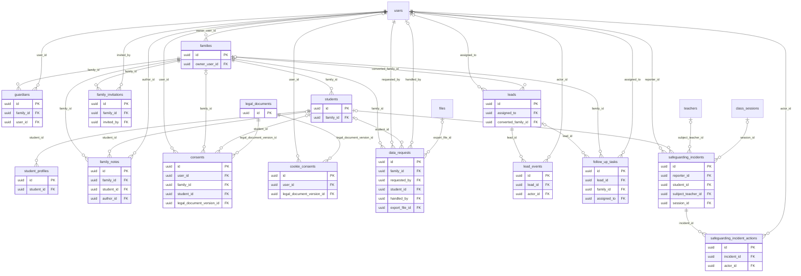

# ERD — Families

الأسرة وحدة الفوترة والصلاحية: كل بيانات ولي الأمر والطفل والموافقات وطلبات البيانات تحمل `family_id` أو تصل إليه. وفي الوحدة أيضاً العملاء المحتملون وبلاغات الحماية.

قاعدة الحد الأدنى (PRV-04، ADR-009): الطفل له اسم أول، وشهر الميلاد وسنته، ومعلومات مستواه، وملاحظة اختيارية من ولي الأمر. لا عمود لصورة الطفل أو بريده أو عنوانه في أي جدول.

<!-- erd:diagram:start -->

<!-- erd:diagram:end -->

### `families`
- Kind: mutable · Spec: families · Reqs: ONB-01, PAR-01, ADM-02, BIL-12, PUB-03 · Scope: family_id (self)

| Column | Type | Null | References | Notes |
| --- | --- | --- | --- | --- |
| id | uuid | no | | PK (v7) |
| owner_user_id | uuid | no | users.id | account owner (ONB-01); a second guardian is R2 (PAR-17) |
| country_code | char(2) | no | | ISO 3166-1; market for D-17, refund rules (BIL-12), price display (PUB-03) |
| ops_assisted | boolean | no | | created by operations (ONB-12) |
| created_by | uuid | yes | users.id | |
| updated_by | uuid | yes | users.id | |
| archived_at | timestamptz | yes | | |
| created_at | timestamptz | no | | |
| updated_at | timestamptz | no | | |

Constraints and indexes:
- `INDEX (owner_user_id)`, `INDEX (country_code)`
- The family's display zone is its guardians' `users.timezone`; there is no family name column (names live on `users` and `students`).

### `guardians`
- Kind: mutable · Spec: guardians · Reqs: ONB-01, PAR-02, RBAC-02 · Scope: family_id

| Column | Type | Null | References | Notes |
| --- | --- | --- | --- | --- |
| id | uuid | no | | PK (v7) |
| family_id | uuid | no | families.id | |
| user_id | uuid | no | users.id | name, email and phone live on `users` |
| is_primary | boolean | no | | |
| archived_at | timestamptz | yes | | |
| created_at | timestamptz | no | | |
| updated_at | timestamptz | no | | |

Constraints and indexes:
- `UNIQUE (user_id)` (one family per guardian account in R1), `UNIQUE (family_id) WHERE is_primary`

### `students`
- Kind: mutable · Spec: students · Reqs: ONB-03, PRV-04, PAR-02, ADM-03, ONB-09, RBAC-02 · Scope: family_id

| Column | Type | Null | References | Notes |
| --- | --- | --- | --- | --- |
| id | uuid | no | | PK (v7) |
| family_id | uuid | no | families.id | |
| first_name | string | no | | PII |
| first_name_normalized | string | yes | | PII; Arabic/Latin normalized for duplicate-trial detection (D-09); null after erasure |
| birth_month | smallint | yes | | PII; 1–12 (PRV-04: month and year only); required at creation (ONB-03), null after erasure |
| birth_year | smallint | yes | | PII; required at creation, null after erasure |
| suspended_at | timestamptz | yes | | ADM-03 «الإيقاف دون حذف» |
| departed_at | timestamptz | yes | | starts the "after the student leaves" retention clocks (F17:45-46); when it is set is WP-5.2's |
| pseudonymized_at | timestamptz | yes | | erasure done (D-14); ledger and invoices keep the id |
| created_by | uuid | yes | users.id | |
| updated_by | uuid | yes | users.id | |
| archived_at | timestamptz | yes | | |
| created_at | timestamptz | no | | |
| updated_at | timestamptz | no | | |

Constraints and indexes:
- `INDEX (family_id)`, `INDEX (first_name_normalized, birth_year, birth_month)` (D-09 match with the guardian's verified phone)
- `CHECK (birth_month BETWEEN 1 AND 12)`
- No photo, email, address or contact column (PRV-04, S:4). The current level is the latest approved `placements` row.
- **VPC gate (D-13, ADR-009 §3):** a `students` row is created only by the guardian, after a granted `consents` row with purpose `child_data` (and its `verification_method`) exists for that guardian. Operations never create children (ONB-12 invites the guardian, who then adds them). WP-1.5 tests this; the FK is not modelled because the consent row may later name the student.

### `student_profiles`
- Kind: mutable · Spec: student_profiles · Reqs: ONB-03, ONB-04, PAR-02 · Scope: student_id → family

| Column | Type | Null | References | Notes |
| --- | --- | --- | --- | --- |
| id | uuid | no | | PK (v7) |
| student_id | uuid | no | students.id | |
| primary_language | string | yes | | PII; ISO 639-1 (ONB-03) |
| arabic_level_estimate | string | yes | | guardian's estimate (ONB-03); scale TBD(WP-1.5) |
| self_assessment | jsonb | yes | | PII; short answers on reading, writing, speaking (ONB-03) |
| notes | text | yes | | PII; guardian's free text, with the "no medical data" warning in the form (ONB-04) |
| updated_by | uuid | yes | users.id | |
| created_at | timestamptz | no | | |
| updated_at | timestamptz | no | | |

Constraints and indexes:
- `UNIQUE (student_id)`

### `family_notes`
- Kind: mutable · Spec: family_notes · Reqs: ADM-02 · Scope: family_id

| Column | Type | Null | References | Notes |
| --- | --- | --- | --- | --- |
| id | uuid | no | | PK (v7) |
| family_id | uuid | no | families.id | |
| student_id | uuid | yes | students.id | when the note is about one child |
| body | text | no | | PII; staff CRM note |
| author_id | uuid | no | users.id | |
| pinned | boolean | no | | |
| archived_at | timestamptz | yes | | |
| created_at | timestamptz | no | | |
| updated_at | timestamptz | no | | |

Constraints and indexes:
- `INDEX (family_id, created_at)`

### `family_invitations`
- Kind: mutable · Spec: NEW (ONB-12 «ترسل رابط دعوة لإكمال الموافقات وكلمة المرور») · Reqs: ONB-12 · Scope: family_id

| Column | Type | Null | References | Notes |
| --- | --- | --- | --- | --- |
| id | uuid | no | | PK (v7) |
| family_id | uuid | no | families.id | |
| email | string | no | | PII |
| token_hash | string | no | | hashed |
| invited_by | uuid | no | users.id | operations user |
| expires_at | timestamptz | no | | |
| accepted_at | timestamptz | yes | | consents and password completed |
| created_at | timestamptz | no | | |
| updated_at | timestamptz | no | | |

Constraints and indexes:
- `UNIQUE (token_hash)`

### `legal_documents`
- Kind: mutable · Spec: legal_documents · Reqs: PUB-05, PRV-01, TOP-03, ONB-01, PUB-10 · Scope: none (public text)

| Column | Type | Null | References | Notes |
| --- | --- | --- | --- | --- |
| id | uuid | no | | PK (v7); one row is one version (glossary model `LegalDocumentVersion`) |
| document_type | string | no | | values: terms\|privacy_policy\|children_privacy_notice\|refund_policy\|child_protection_policy\|cookie_policy\|teacher_contract\|code_of_conduct (PUB-05, TOP-03, PUB-10) |
| market | char(2) | yes | | for market-specific texts (refund policy, PUB-05) |
| version | string | no | | e.g. `2026-12` |
| title_ar | string | no | | |
| title_en | string | no | | |
| body_ar | text | no | | |
| body_en | text | no | | |
| published_at | timestamptz | yes | | immutable once published; a change is a new version |
| created_by | uuid | yes | users.id | |
| updated_by | uuid | yes | users.id | |
| created_at | timestamptz | no | | |
| updated_at | timestamptz | no | | |

Constraints and indexes:
- `UNIQUE (document_type, market, version)` (with `NULLS NOT DISTINCT`)

### `consents`
- Kind: append-only · Spec: consents · Reqs: ONB-01, PRV-01, PRV-02, PRV-03, PAR-13, CLS-10, STU-08, TOP-03, SAFE-04 · Scope: family_id (null for staff acknowledgements)

| Column | Type | Null | References | Notes |
| --- | --- | --- | --- | --- |
| id | uuid | no | | PK (v7) |
| user_id | uuid | no | users.id | adult who consents or acknowledges |
| family_id | uuid | yes | families.id | |
| student_id | uuid | yes | students.id | per-child consents (recording, P:20, D-11) |
| purpose | string | no | | values: terms\|privacy_notice\|child_data\|third_party_sharing\|recording\|service_start_in_withdrawal_period\|teacher_contract\|code_of_conduct\|child_protection_policy (PRV-01..03, D-11, S10:33, TOP-03, SAFE-04) |
| legal_document_version_id | uuid | no | legal_documents.id | the exact text agreed to (spec/14) |
| granted_at | timestamptz | yes | | |
| withdrawn_at | timestamptz | yes | | withdrawal is a new row (spec/14) |
| verification_method | string | yes | | D-13 (Open): method of verifiable parental consent; CHECK added when decided |
| ip | inet | yes | | PII |
| user_agent | text | yes | | PII |
| created_at | timestamptz | no | | |

Constraints and indexes:
- `CHECK (num_nonnulls(granted_at, withdrawn_at) = 1)`
- `INDEX (user_id, purpose, student_id, created_at)`: the latest row per (user, purpose, student) is the current state
- Kept for the account's life + 3 years (D-15), then deleted by `sura_retention`; an erasure request does not shorten it (legal evidence).

### `cookie_consents`
- Kind: append-only · Spec: NEW (PUB-10: a visitor has no `users` row, so `consents` cannot hold it) · Reqs: PUB-10, PRV-10 · Scope: none

| Column | Type | Null | References | Notes |
| --- | --- | --- | --- | --- |
| id | uuid | no | | PK (v7) |
| visitor_ref | string | no | | PII; random first-party identifier stored in the consent cookie |
| user_id | uuid | yes | users.id | when signed in |
| choices | jsonb | no | | `{essential: true, analytics: bool, marketing: bool}`; marketing is opt-in only |
| legal_document_version_id | uuid | no | legal_documents.id | cookie policy version |
| created_at | timestamptz | no | | |

Constraints and indexes:
- `INDEX (visitor_ref, created_at)`; a change of choice is a new row.

### `data_requests`
- Kind: mutable · Spec: data_requests · Reqs: PRV-07, PAR-13 · Scope: family_id

| Column | Type | Null | References | Notes |
| --- | --- | --- | --- | --- |
| id | uuid | no | | PK (v7) |
| family_id | uuid | no | families.id | |
| requested_by | uuid | no | users.id | |
| student_id | uuid | yes | students.id | when the request is about one child |
| request_type | string | no | | values: access\|correct\|delete\|stop_use (PRV-07) |
| status | string | no | | values: received\|in_progress\|completed\|rejected (proposed) |
| due_at | timestamptz | no | | created_at + 30 days (PRV-07) |
| completed_at | timestamptz | yes | | |
| handled_by | uuid | yes | users.id | |
| resolution_note | text | yes | | PII |
| export_file_id | uuid | yes | files.id | data copy for `access` |
| created_at | timestamptz | no | | |
| updated_at | timestamptz | no | | |

Constraints and indexes:
- `INDEX (status, due_at)`
- The export file is downloadable only by a signed link of at most 10 minutes, each access logged in `audit_logs`, and deleted 30 days after `completed_at` (proposed, legal review in WP-0.8).

### `leads`
- Kind: mutable · Spec: leads · Reqs: PUB-06, PUB-08, ADM-02, ONB-08 · Scope: none (operations)

| Column | Type | Null | References | Notes |
| --- | --- | --- | --- | --- |
| id | uuid | no | | PK (v7) |
| name | string | yes | | PII |
| email | string | yes | | PII |
| phone_e164 | string | yes | | PII |
| country_code | char(2) | yes | | |
| source | string | no | | values: waitlist_form\|contact_form\|signup\|operations (proposed; PUB-06, PUB-08) |
| message | text | yes | | PII; contact-form text (PUB-06) |
| utm_source | string | yes | | PUB-08 |
| utm_medium | string | yes | | |
| utm_campaign | string | yes | | |
| referral_code | string | yes | | PUB-08 |
| stage | string | no | | lead pipeline stage; TBD(WP-4.1) (ADM-02 names stages without listing them) |
| assigned_to | uuid | yes | users.id | |
| converted_family_id | uuid | yes | families.id | |
| delete_after_at | timestamptz | yes | | 12 months without subscription (F17:48) |
| archived_at | timestamptz | yes | | |
| created_at | timestamptz | no | | |
| updated_at | timestamptz | no | | |

Constraints and indexes:
- `INDEX (stage, created_at)`, `INDEX (email)`, `INDEX (delete_after_at)`
- On conversion `delete_after_at` = conversion + 30 days (proposed): the family record then holds the data, so the lead's copy is erased.

### `lead_events`
- Kind: mutable · Spec: lead_events · Reqs: ADM-02 · Scope: none (operations)

| Column | Type | Null | References | Notes |
| --- | --- | --- | --- | --- |
| id | uuid | no | | PK (v7) |
| lead_id | uuid | no | leads.id | |
| kind | string | no | | TBD(WP-4.1) |
| body | text | yes | | PII |
| actor_id | uuid | yes | users.id | |
| occurred_at | timestamptz | no | | |
| created_at | timestamptz | no | | |
| updated_at | timestamptz | no | | |

Constraints and indexes:
- `INDEX (lead_id, occurred_at)`; deleted with the lead.

### `follow_up_tasks`
- Kind: mutable · Spec: follow_up_tasks · Reqs: ADM-02 · Scope: family_id (null for a lead)

| Column | Type | Null | References | Notes |
| --- | --- | --- | --- | --- |
| id | uuid | no | | PK (v7) |
| lead_id | uuid | yes | leads.id | |
| family_id | uuid | yes | families.id | |
| title | string | no | | PII (CRM text can name a child) |
| body | text | yes | | PII |
| assigned_to | uuid | no | users.id | |
| due_at | timestamptz | no | | |
| status | string | no | | values: open\|done\|cancelled (proposed) |
| completed_at | timestamptz | yes | | |
| created_by | uuid | yes | users.id | |
| updated_by | uuid | yes | users.id | |
| created_at | timestamptz | no | | |
| updated_at | timestamptz | no | | |

Constraints and indexes:
- `CHECK (num_nonnulls(lead_id, family_id) = 1)`, `INDEX (assigned_to, status, due_at)`

### `safeguarding_incidents`
- Kind: mutable · Spec: safeguarding_incidents · Reqs: SAFE-01, SAFE-02, ADM-14, CLS-12 · Scope: none (restricted to safeguarding officer and system admin, F17:57)

| Column | Type | Null | References | Notes |
| --- | --- | --- | --- | --- |
| id | uuid | no | | PK (v7) |
| reporter_id | uuid | no | users.id | guardian, teacher or staff (SAFE-01) |
| reporter_role | string | no | | values: guardian\|teacher\|staff |
| channel | string | no | | values: report_button\|session_emergency\|other (SAFE-01, CLS-12) |
| student_id | uuid | yes | students.id | |
| student_first_name_snapshot | string | yes | | PII; keeps the subject readable for the 7-year record after the student is pseudonymized |
| subject_teacher_id | uuid | yes | teachers.id | the teacher the concern is about (SAFE-06 suspension links here) |
| session_id | uuid | yes | class_sessions.id | when raised from a session (CLS-12) |
| description | text | no | | PII; immutable after insert (trigger); corrections go to `safeguarding_incident_actions` |
| status | string | no | | TBD(WP-1.5) |
| reported_at | timestamptz | no | | |
| officer_notified_at | timestamptz | yes | | within 24 h at the latest (SAFE-01); sent immediately with top priority (spec/21) |
| closed_at | timestamptz | yes | | |
| created_at | timestamptz | no | | |
| updated_at | timestamptz | no | | |

Constraints and indexes:
- `INDEX (status, reported_at)`
- Kept 7 years (D-15). While an incident is open, records tied to it may be put on hold (`legal_holds`, D-38). Technical problems from the session emergency button go to `support_threads`, not here.

### `safeguarding_incident_actions`
- Kind: append-only · Spec: NEW (SAFE-02 «سجل مقيد بكل خطوة متخذة») · Reqs: SAFE-02 · Scope: none (as the incident)

| Column | Type | Null | References | Notes |
| --- | --- | --- | --- | --- |
| id | uuid | no | | PK (v7) |
| incident_id | uuid | no | safeguarding_incidents.id | |
| action_taken | text | no | | PII |
| actor_id | uuid | no | users.id | |
| occurred_at | timestamptz | no | | |
| created_at | timestamptz | no | | |

Constraints and indexes:
- `INDEX (incident_id, occurred_at)`; kept with the incident (7 years, D-15).
