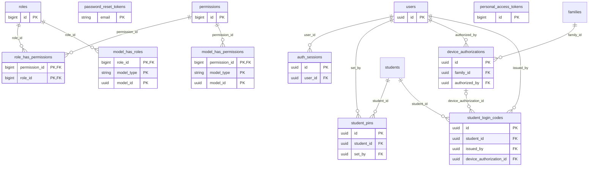

# ERD — Identity

حسابات البالغين (أولياء الأمور والمعلمات والموظفون) ودخولهم، والتحقق الثنائي (SEC-02)، وفهرس الجلسات والأجهزة (SEC-03)، والأدوار والصلاحيات (RBAC-01).

الطفل ليس مستخدماً في `users`: لا بريد ولا كلمة مرور (S:4، المسرد). يدخل وضع الطفل برمزه أو برمز لمرة واحدة على جهاز وافق عليه ولي الأمر، ويحصل على رمز Sanctum قصير العمر (spec/15).

<!-- erd:diagram:start -->

<!-- erd:diagram:end -->

### `users`
- Kind: mutable · Spec: users (+ mfa_factors, merged) · Reqs: ONB-01, ONB-02, SEC-01, SEC-02, SEC-03, SEC-14, NOT-01, RBAC-05 · Scope: own record

| Column | Type | Null | References | Notes |
| --- | --- | --- | --- | --- |
| id | uuid | no | | PK (v7) |
| name | string | no | | PII; display name of the adult |
| email | string | no | | PII; stored lower-case |
| email_verified_at | timestamptz | yes | | ONB-02 |
| phone_e164 | string | yes | | PII; E.164 with country code (ONB-01, D-09) |
| phone_verified_at | timestamptz | yes | | OTP via Twilio Verify; the code itself is never stored (ONB-02) |
| password | string | yes | | hashed (Argon2id, SEC-01); null until an invited account sets it (ONB-12) |
| remember_token | string | yes | | hashed |
| two_factor_secret | text | yes | | encrypted; Fortify TOTP (SEC-02) |
| two_factor_recovery_codes | text | yes | | encrypted |
| two_factor_confirmed_at | timestamptz | yes | | |
| locale | string | no | | values: ar\|en (communication language, ONB-01; template language, NOT-01) |
| timezone | string | no | | IANA; inferred at signup then editable (ONB-01, P:4) |
| status | string | no | | values: active\|suspended\|closed (proposed; SEC-14 suspend, RBAC-05 revoke) |
| suspended_at | timestamptz | yes | | |
| last_login_at | timestamptz | yes | | |
| pseudonymized_at | timestamptz | yes | | set when an erasure request replaced the personal fields (D-14) |
| created_at | timestamptz | no | | |
| updated_at | timestamptz | no | | |

Constraints and indexes:
- `UNIQUE (email)`, `UNIQUE (phone_e164) WHERE phone_e164 IS NOT NULL`
- Whether a role must have MFA comes from `roles.requires_mfa` (SEC-02: mandatory for staff and teachers, optional for parents).

### `password_reset_tokens`
- Kind: framework · Spec: NEW (Laravel/Fortify password reset) · Reqs: SEC-01 · Scope: none

| Column | Type | Null | References | Notes |
| --- | --- | --- | --- | --- |
| email | string | no | | PK; PII |
| token | string | no | | hashed |
| created_at | timestamptz | yes | | expires after 60 minutes |

### `auth_sessions`
- Kind: mutable · Spec: auth_sessions · Reqs: SEC-03, SEC-14 · Scope: user_id

| Column | Type | Null | References | Notes |
| --- | --- | --- | --- | --- |
| id | uuid | no | | PK (v7) |
| user_id | uuid | no | users.id | |
| session_key_hash | string | no | | hashed Redis session id, used to revoke it |
| device_label | string | yes | | derived from the user agent, e.g. "Chrome · Windows" |
| ip | inet | yes | | PII; last seen address |
| user_agent | text | yes | | PII |
| last_active_at | timestamptz | no | | staff idle limit 30 min (SEC-03) |
| revoked_at | timestamptz | yes | | "sign out everywhere", incident response (SEC-14) |
| created_at | timestamptz | no | | |
| updated_at | timestamptz | no | | |

Constraints and indexes:
- `UNIQUE (session_key_hash)`, `INDEX (user_id) WHERE revoked_at IS NULL`

### `student_pins`
- Kind: mutable · Spec: student_pins · Reqs: SEC-04, PAR-14, STU-01 · Scope: student_id → family

| Column | Type | Null | References | Notes |
| --- | --- | --- | --- | --- |
| id | uuid | no | | PK (v7) |
| student_id | uuid | no | students.id | |
| pin_hash | string | no | | hashed; 4–6 digits (SEC-04) |
| failed_attempts | smallint | no | | reset on success |
| locked_until_at | timestamptz | yes | | `security.child_pin_attempts` / `lock_min` (5 / 15) |
| set_by | uuid | no | users.id | guardian who set the PIN |
| created_at | timestamptz | no | | |
| updated_at | timestamptz | no | | |

Constraints and indexes:
- `UNIQUE (student_id)`

### `device_authorizations`
- Kind: mutable · Spec: device_authorizations · Reqs: SEC-04, STU-01, PAR-14 · Scope: family_id

| Column | Type | Null | References | Notes |
| --- | --- | --- | --- | --- |
| id | uuid | no | | PK (v7) |
| family_id | uuid | no | families.id | a device is authorized for the family; siblings pick their profile, then enter their PIN |
| device_key_hash | string | no | | hashed device secret kept in a first-party cookie |
| device_label | string | yes | | guardian-chosen name, e.g. "تابلت البيت" |
| authorized_by | uuid | no | users.id | guardian |
| last_used_at | timestamptz | yes | | |
| revoked_at | timestamptz | yes | | |
| created_at | timestamptz | no | | |
| updated_at | timestamptz | no | | |

Constraints and indexes:
- `UNIQUE (device_key_hash)`, `INDEX (family_id) WHERE revoked_at IS NULL`

### `student_login_codes`
- Kind: mutable · Spec: NEW (STU-01 «برمز لمرة واحدة أو QR من بوابة ولي الأمر») · Reqs: STU-01 · Scope: student_id → family

| Column | Type | Null | References | Notes |
| --- | --- | --- | --- | --- |
| id | uuid | no | | PK (v7) |
| student_id | uuid | no | students.id | |
| method | string | no | | values: one_time_code\|qr |
| code_hash | string | no | | hashed |
| issued_by | uuid | no | users.id | guardian |
| expires_at | timestamptz | no | | short-lived |
| consumed_at | timestamptz | yes | | single use |
| device_authorization_id | uuid | yes | device_authorizations.id | the device that redeemed it and became authorized |
| created_at | timestamptz | no | | |
| updated_at | timestamptz | no | | |

Constraints and indexes:
- `UNIQUE (code_hash)`

### `roles`
- Kind: package · Spec: roles · Reqs: RBAC-01, SEC-02 · Scope: none

| Column | Type | Null | References | Notes |
| --- | --- | --- | --- | --- |
| id | bigint | no | | PK (spatie/laravel-permission) |
| name | string | no | | guardian, teacher, academic_supervisor, operations, finance, content_manager, system_admin, safeguarding_officer (01:19-27, F17:57) |
| guard_name | string | no | | |
| requires_mfa | boolean | no | | added by us: SEC-02 |
| created_at | timestamptz | yes | | |
| updated_at | timestamptz | yes | | |

Constraints and indexes:
- `UNIQUE (name, guard_name)`

### `permissions`
- Kind: package · Spec: permissions · Reqs: RBAC-01 · Scope: none

| Column | Type | Null | References | Notes |
| --- | --- | --- | --- | --- |
| id | bigint | no | | PK |
| name | string | no | | e.g. `attendance.mark`, `payments.refund` (RBAC-01) |
| guard_name | string | no | | |
| created_at | timestamptz | yes | | |
| updated_at | timestamptz | yes | | |

Constraints and indexes:
- `UNIQUE (name, guard_name)`

### `role_has_permissions`
- Kind: package · Spec: role_permissions · Reqs: RBAC-01 · Scope: none

| Column | Type | Null | References | Notes |
| --- | --- | --- | --- | --- |
| permission_id | bigint | no | permissions.id | PK |
| role_id | bigint | no | roles.id | PK |

### `model_has_roles`
- Kind: package · Spec: user_roles · Reqs: RBAC-01, RBAC-05 · Scope: none

| Column | Type | Null | References | Notes |
| --- | --- | --- | --- | --- |
| role_id | bigint | no | roles.id | PK |
| model_type | string | no | | PK |
| model_id | uuid | no | | PK; polymorphic (uuid morph key: users are uuid) |

Constraints and indexes:
- Revoking a role deletes the row and writes `role.revoked` to `audit_logs` (RBAC-05).

### `model_has_permissions`
- Kind: package · Spec: NEW (spatie direct permissions; unused by policy, created by the package) · Reqs: RBAC-01 · Scope: none

| Column | Type | Null | References | Notes |
| --- | --- | --- | --- | --- |
| permission_id | bigint | no | permissions.id | PK |
| model_type | string | no | | PK |
| model_id | uuid | no | | PK; polymorphic |

### `personal_access_tokens`
- Kind: package · Spec: NEW (Sanctum; short-lived child-mode token, spec/15) · Reqs: STU-01, PAR-14 · Scope: none

| Column | Type | Null | References | Notes |
| --- | --- | --- | --- | --- |
| id | bigint | no | | PK |
| tokenable_type | string | no | | `Student` for child mode |
| tokenable_id | uuid | no | | polymorphic (uuid morphs) |
| name | string | no | | |
| token | string | no | | hashed |
| abilities | text | yes | | |
| last_used_at | timestamptz | yes | | |
| expires_at | timestamptz | yes | | always set for child tokens |
| created_at | timestamptz | yes | | |
| updated_at | timestamptz | yes | | |

Constraints and indexes:
- `UNIQUE (token)`
