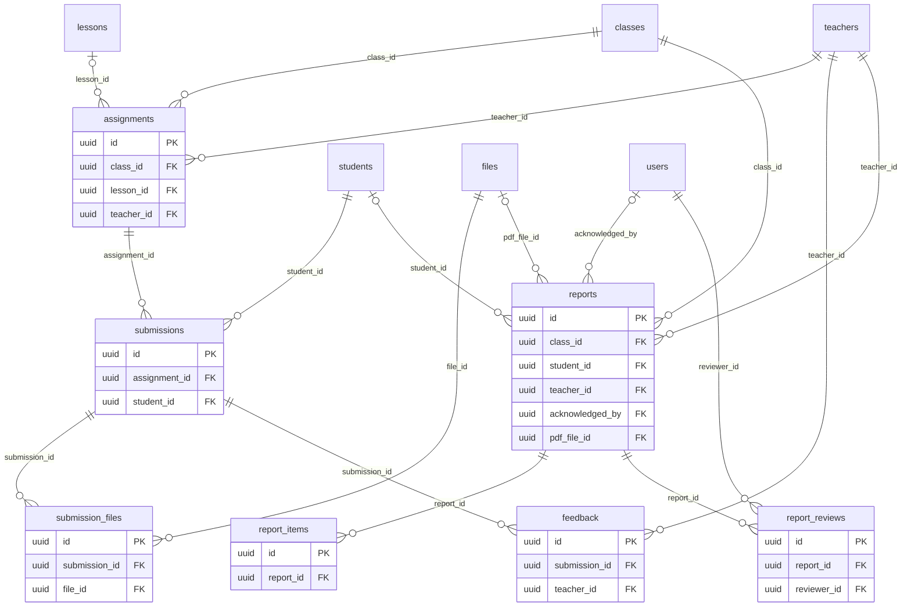

# ERD — Learning

الواجبات والتسليمات بكل نسخها (HW-03)، والتصحيح والملاحظات، والتقارير بحالاتها، ومراجعتها بالعينة (RPT-05).

ملفات الواجبات والتسجيلات الصوتية تُحذف بعد 12 شهراً من مغادرة الطالب. التقارير والدرجات تُخفى هويتها بعد 3 سنوات (F17:45-46). صفوف التقارير لا تُحذف (spec/14)، بل تُمحى منها النصوص الشخصية.

<!-- erd:diagram:start -->

<!-- erd:diagram:end -->

### `assignments`
- Kind: mutable · Spec: assignments · Reqs: HW-01, HW-05, TCH-07, STU-06, CNT-04 · Scope: class_id

| Column | Type | Null | References | Notes |
| --- | --- | --- | --- | --- |
| id | uuid | no | | PK (v7) |
| class_id | uuid | no | classes.id | |
| lesson_id | uuid | yes | lessons.id | linked lesson (HW-01) |
| teacher_id | uuid | no | teachers.id | |
| title | string | no | | |
| instructions_ar | text | no | | HW-01 |
| instructions_en | text | yes | | |
| submission_type | string | no | | values: text\|image\|audio\|file (HW-02) |
| due_at | timestamptz | no | | set in the class's local time (HW-01), stored in UTC |
| closes_at | timestamptz | no | | resubmission and late submission allowed until then (HW-03, HW-05) |
| status | string | no | | values: draft\|published\|closed\|archived (proposed) |
| published_at | timestamptz | yes | | |
| reminder_sent_at | timestamptz | yes | | one day before `due_at` (HW-05) |
| created_by | uuid | yes | users.id | |
| updated_by | uuid | yes | users.id | |
| created_at | timestamptz | no | | |
| updated_at | timestamptz | no | | |

Constraints and indexes:
- `CHECK (closes_at >= due_at)`, `INDEX (class_id, due_at)`
- Attachments are `files` rows owned by the assignment.

### `submissions`
- Kind: mutable · Spec: submissions · Reqs: HW-02, HW-03, STU-06, TCH-01 · Scope: student_id → family; class via assignment

| Column | Type | Null | References | Notes |
| --- | --- | --- | --- | --- |
| id | uuid | no | | PK (v7) |
| assignment_id | uuid | no | assignments.id | |
| student_id | uuid | no | students.id | |
| version_no | smallint | no | | every version is kept (HW-03) |
| submission_type | string | no | | values: text\|image\|audio\|file (HW-02) |
| text_body | text | yes | | PII; typed on the Arabic keyboard |
| audio_seconds | smallint | yes | | ≤ 180 (HW-02) |
| is_late | boolean | no | | after `due_at` |
| submitted_at | timestamptz | no | | |
| created_at | timestamptz | no | | |
| updated_at | timestamptz | no | | |

Constraints and indexes:
- `UNIQUE (assignment_id, student_id, version_no)`, `CHECK (audio_seconds IS NULL OR audio_seconds <= 180)`

### `submission_files`
- Kind: mutable · Spec: submission_files · Reqs: HW-02, HW-06, STU-06 · Scope: via submission

| Column | Type | Null | References | Notes |
| --- | --- | --- | --- | --- |
| id | uuid | no | | PK (v7) |
| submission_id | uuid | no | submissions.id | |
| file_id | uuid | no | files.id | image metadata stripped before storage (HW-06) |
| kind | string | no | | values: image\|audio\|file |
| created_at | timestamptz | no | | |
| updated_at | timestamptz | no | | |

Constraints and indexes:
- `UNIQUE (file_id)`

### `feedback`
- Kind: mutable · Spec: feedback · Reqs: HW-04, TCH-07, STU-06, PAR-03 · Scope: via submission

| Column | Type | Null | References | Notes |
| --- | --- | --- | --- | --- |
| id | uuid | no | | PK (v7) |
| submission_id | uuid | no | submissions.id | |
| teacher_id | uuid | no | teachers.id | |
| score | smallint | yes | | HW-04 «درجة» |
| rubric | jsonb | yes | | HW-04 «أو معيار تقييم»; scale chosen in WP-4.6 |
| note | text | yes | | PII |
| status | string | no | | values: draft\|published (visible to student and guardian only when published, HW-04) |
| published_at | timestamptz | yes | | |
| created_at | timestamptz | no | | |
| updated_at | timestamptz | no | | |

Constraints and indexes:
- `UNIQUE (submission_id)`

### `reports`
- Kind: mutable · Spec: reports · Reqs: RPT-01, RPT-02, RPT-03, RPT-04, RPT-05, RPT-06, TCH-08, PAR-10, ADM-10 · Scope: class_id; student_id → family

| Column | Type | Null | References | Notes |
| --- | --- | --- | --- | --- |
| id | uuid | no | | PK (v7) |
| kind | string | no | | values: weekly_student\|weekly_class\|monthly (RPT-01..03; level reports are R2, RPT-07) |
| class_id | uuid | no | classes.id | |
| student_id | uuid | yes | students.id | null for the weekly class summary (RPT-02) |
| teacher_id | uuid | no | teachers.id | |
| period_start_on | date | no | | |
| period_end_on | date | no | | |
| status | string | no | | values: task\|draft\|submitted\|returned\|published\|acknowledged (spec/14) |
| due_at | timestamptz | no | | task deadline; lateness alerts teacher and supervisor (RPT-04) |
| selected_for_review | boolean | no | | all for a teacher's first `reports.new_teacher_full_review_months`, then `reports.review_sample_pct` (RPT-05) |
| submitted_at | timestamptz | yes | | |
| published_at | timestamptz | yes | | |
| acknowledged_at | timestamptz | yes | | read time recorded (RPT-06) |
| acknowledged_by | uuid | yes | users.id | |
| pdf_file_id | uuid | yes | files.id | |
| created_at | timestamptz | no | | |
| updated_at | timestamptz | no | | |

Constraints and indexes:
- `UNIQUE (kind, class_id, student_id, period_start_on) NULLS NOT DISTINCT`, `INDEX (teacher_id, status, due_at)`

### `report_items`
- Kind: mutable · Spec: report_items · Reqs: RPT-01, RPT-02, RPT-03 · Scope: via report

| Column | Type | Null | References | Notes |
| --- | --- | --- | --- | --- |
| id | uuid | no | | PK (v7) |
| report_id | uuid | no | reports.id | |
| item_key | string | no | | values: attendance\|participation\|homework_status\|skill_of_week\|note\|topics_covered\|homework\|next_week_goals\|reading\|writing\|listening\|speaking\|values_culture\|recommendations (RPT-01..03) |
| score | smallint | yes | | participation 1–5 (RPT-01) |
| body | text | yes | | PII |
| created_at | timestamptz | no | | |
| updated_at | timestamptz | no | | |

Constraints and indexes:
- `UNIQUE (report_id, item_key)`, `CHECK (score IS NULL OR score BETWEEN 1 AND 5)`

### `report_reviews`
- Kind: mutable · Spec: report_reviews · Reqs: RPT-05, ADM-10 · Scope: via report

| Column | Type | Null | References | Notes |
| --- | --- | --- | --- | --- |
| id | uuid | no | | PK (v7) |
| report_id | uuid | no | reports.id | |
| reviewer_id | uuid | no | users.id | academic supervisor |
| decision | string | no | | values: approved\|returned (RPT-05 «إعادة للتعديل بتعليق») |
| comment | text | yes | | |
| decided_at | timestamptz | no | | |
| created_at | timestamptz | no | | |
| updated_at | timestamptz | no | | |

Constraints and indexes:
- `INDEX (report_id, decided_at)`
