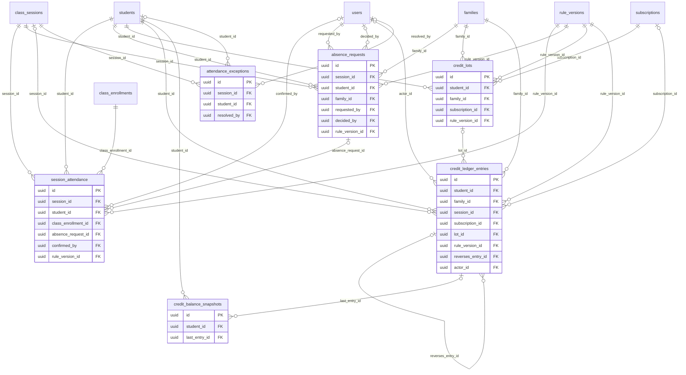

# ERD — Ledger

الحضور، وطلبات الغياب، ودفتر الرصيد للإضافة فقط (ADR-007، الدستور م5)، ودفعات الرصيد (D-05)، ولقطات الرصيد، واستثناءات الحضور.

- **الرصيد:** مجموع `qty` للطالب والوعاء، يُحسب من الدفتر دائماً. اللقطات كاش يُعاد بناؤه، ومهمة يومية تقارنها بالدفتر.
- **التصحيح:** قيد `REVERSAL` يشير إلى الأصل، ثم القيد الصحيح. لا تعديل ولا حذف، ومحفّز في قاعدة البيانات يرفضهما.
- **دفعة الرصيد:** كل دفعة تُنشأ قبل قيد الشراء الذي يشير إليها (`lot_id`). ما بقي فيها مجموع قيودها، فهي مشتقة من الدفتر ولا تغيّر طبيعته الإضافية.

<!-- erd:diagram:start -->

<!-- erd:diagram:end -->

### `session_attendance`
- Kind: mutable · Spec: session_attendance · Reqs: ATT-01, ATT-05, TCH-05, CLS-09, RPT-01, PAR-03, ADM-09 · Scope: via session → class; student_id → family

| Column | Type | Null | References | Notes |
| --- | --- | --- | --- | --- |
| id | uuid | no | | PK (v7) |
| session_id | uuid | no | class_sessions.id | |
| student_id | uuid | no | students.id | |
| class_enrollment_id | uuid | no | class_enrollments.id | regular or trial seat (D-08) |
| suggested_status | string | yes | | values: PRESENT\|LATE\|PARTIAL\|ABSENT_EXCUSED\|ABSENT_UNEXCUSED (from participant events, CLS-09) |
| status | string | yes | | values: PRESENT\|LATE\|PARTIAL\|ABSENT_EXCUSED\|ABSENT_UNEXCUSED (confirmed) |
| first_joined_at | timestamptz | yes | | |
| last_left_at | timestamptz | yes | | |
| attended_minutes | smallint | yes | | |
| absence_request_id | uuid | yes | absence_requests.id | |
| confirmed_by | uuid | yes | users.id | teacher, within `attendance.teacher_confirm_hours` |
| confirmed_at | timestamptz | yes | | |
| auto_approved_at | timestamptz | yes | | suggestion approved after the window and flagged to the supervisor (spec/15) |
| locked_at | timestamptz | yes | | edits after lock: permission + reason + REVERSAL (ATT-05) |
| rule_version_id | uuid | no | rule_versions.id | thresholds used for the suggestion |
| created_at | timestamptz | no | | |
| updated_at | timestamptz | no | | |

Constraints and indexes:
- `UNIQUE (session_id, student_id)`, `INDEX (student_id, session_id)`
- A change after `locked_at` writes `audit_logs` with the reason and the matching ledger REVERSAL in one transaction.

### `absence_requests`
- Kind: mutable · Spec: absence_requests · Reqs: ATT-02, ATT-03, PAR-05 · Scope: family_id

| Column | Type | Null | References | Notes |
| --- | --- | --- | --- | --- |
| id | uuid | no | | PK (v7) |
| session_id | uuid | no | class_sessions.id | |
| student_id | uuid | no | students.id | |
| family_id | uuid | no | families.id | |
| requested_by | uuid | no | users.id | |
| requested_at | timestamptz | no | | compared in UTC with `class_sessions.starts_at`; exactly 24 h counts as in time (ATT-02) |
| reason | text | yes | | PII |
| status | string | no | | values: submitted\|auto_accepted\|pending_review\|accepted\|rejected (spec/14) |
| within_cutoff | boolean | no | | `attendance.excuse_cutoff_hours` |
| within_cap | boolean | no | | sliding window of the last 8 scheduled sessions, `attendance.max_excused_per_8` (D-06) |
| decided_by | uuid | yes | users.id | |
| decided_at | timestamptz | yes | | |
| decision_note | text | yes | | |
| rule_version_id | uuid | no | rule_versions.id | |
| created_at | timestamptz | no | | |
| updated_at | timestamptz | no | | |

Constraints and indexes:
- `UNIQUE (session_id, student_id) WHERE status <> 'rejected'`

### `credit_lots`
- Kind: derived · Spec: NEW (D-05; data-model-conventions.md) · Reqs: ATT-07, BIL-07, BIL-13, BIL-14 · Scope: family_id

| Column | Type | Null | References | Notes |
| --- | --- | --- | --- | --- |
| id | uuid | no | | PK (v7) |
| student_id | uuid | no | students.id | |
| family_id | uuid | no | families.id | |
| subscription_id | uuid | no | subscriptions.id | |
| pool | string | no | | values: paid (trial credits form no lot) |
| qty_granted | integer | no | | `subscription.sessions_per_cycle` at purchase |
| effective_at | timestamptz | no | | payment success (D-05) |
| cycle_end_at | timestamptz | no | | effective_at + `subscription.cycle_weeks` |
| expires_at | timestamptz | no | | cycle_end_at + `credits.expiry_days_after_cycle`; extended by actual freeze time (D-05) |
| frozen_days | integer | no | | total freeze extension so far |
| unit_price_minor | bigint | no | | actual price paid per session in this lot (D-28 wallet conversion) |
| currency | char(3) | no | | |
| rule_version_id | uuid | no | rule_versions.id | |
| created_at | timestamptz | no | | |
| updated_at | timestamptz | no | | |

Constraints and indexes:
- `INDEX (student_id, pool, expires_at)`: consumption takes the lot that expires first (FIFO by `expires_at`, D-05)
- Remaining = `qty_granted` + Σ `qty` of entries with this `lot_id` other than the purchase; rebuildable from the ledger.

### `credit_ledger_entries`
- Kind: append-only · Spec: credit_ledger_entries · Reqs: ATT-04, ATT-05, ATT-07, ATT-08, ATT-09, ADM-09, BIL-06, BIL-12, BIL-13, PAR-07, RBAC-04 · Scope: family_id; student_id

| Column | Type | Null | References | Notes |
| --- | --- | --- | --- | --- |
| id | uuid | no | | PK (v7) |
| student_id | uuid | no | students.id | |
| family_id | uuid | no | families.id | |
| pool | string | no | | values: paid\|trial (BR-018) |
| type | string | no | | values: CREDIT_PURCHASE\|CREDIT_TRIAL\|CONSUMPTION_ATTENDANCE\|ABSENCE_UNEXCUSED\|EXTENSION_ABSENCE_EXCUSED\|COMPENSATION_ACADEMY\|ADJUSTMENT_MANUAL\|CREDIT_EXPIRY\|REVERSAL\|CONVERSION_TO_WALLET (ADR-007, D-28) |
| qty | integer | no | | signed: +8 purchase, −1 consumption, 0 excused, −original for a reversal |
| session_id | uuid | yes | class_sessions.id | |
| subscription_id | uuid | yes | subscriptions.id | |
| lot_id | uuid | yes | credit_lots.id | lot granted or consumed |
| rule_version_id | uuid | no | rule_versions.id | ATT-04 |
| reason | text | yes | | required for ADJUSTMENT_MANUAL, REVERSAL, COMPENSATION_ACADEMY and a second CREDIT_TRIAL (D-29) |
| reverses_entry_id | uuid | yes | credit_ledger_entries.id | |
| idempotency_key | string | no | | Art. 10 |
| actor_type | string | no | | values: user\|system |
| actor_id | uuid | yes | users.id | null for system jobs |
| created_at | timestamptz | no | | |

Constraints and indexes:
- `UNIQUE (student_id, session_id, type) WHERE type IN ('CONSUMPTION_ATTENDANCE','ABSENCE_UNEXCUSED','EXTENSION_ABSENCE_EXCUSED','COMPENSATION_ACADEMY')`: the constitution's double-charge key for session entries (Art. 5 §2). A REVERSAL keeps the original's `session_id` but is outside the key. A post-lock edit that must re-post a session type already reversed in the same session (A→B→A) is posted as `ADJUSTMENT_MANUAL` with `session_id` and a reason (WP-2.3).
- `UNIQUE (reverses_entry_id)`: an entry is reversed at most once.
- `UNIQUE (idempotency_key)`.
- `UNIQUE (lot_id) WHERE type = 'CREDIT_PURCHASE'`: one purchase per lot.
- `CHECK ((type = 'REVERSAL') = (reverses_entry_id IS NOT NULL))`
- `CHECK (session_id IS NOT NULL OR type NOT IN ('CONSUMPTION_ATTENDANCE','ABSENCE_UNEXCUSED','EXTENSION_ABSENCE_EXCUSED','COMPENSATION_ACADEMY'))`
- `CHECK (type <> 'EXTENSION_ABSENCE_EXCUSED' OR qty = 0)`
- `INDEX (student_id, pool, created_at)`, `INDEX (session_id)`, `INDEX (lot_id)`
- Trigger `forbid_mutation` rejects UPDATE and DELETE; `sura_app` has neither privilege (data-model-conventions.md). Rows are never deleted, also not on an erasure request: the student id becomes opaque (D-14).

### `credit_balance_snapshots`
- Kind: derived · Spec: credit_balance_snapshots · Reqs: ATT-07, PAR-01, PAR-07 · Scope: student_id → family

| Column | Type | Null | References | Notes |
| --- | --- | --- | --- | --- |
| id | uuid | no | | PK (v7) |
| student_id | uuid | no | students.id | |
| pool | string | no | | values: paid\|trial |
| kind | string | no | | values: current\|month_end (month-end feeds the "active students" KPI, A:27) |
| balance | integer | no | | |
| last_entry_id | uuid | yes | credit_ledger_entries.id | last entry included |
| as_of_at | timestamptz | no | | |
| created_at | timestamptz | no | | |
| updated_at | timestamptz | no | | |

Constraints and indexes:
- `UNIQUE (student_id, pool) WHERE kind = 'current'`, `UNIQUE (student_id, pool, as_of_at) WHERE kind = 'month_end'`
- A daily job compares each `current` row with the ledger sum and alerts on any difference (ADR-007).

### `attendance_exceptions`
- Kind: mutable · Spec: attendance_exceptions · Reqs: ATT-06, ADM-09, ADM-01 · Scope: via session → class

| Column | Type | Null | References | Notes |
| --- | --- | --- | --- | --- |
| id | uuid | no | | PK (v7) |
| session_id | uuid | no | class_sessions.id | |
| student_id | uuid | yes | students.id | |
| kind | string | no | | values: dispute\|conflicting_data\|late_confirmation (ATT-06) |
| status | string | no | | values: open\|resolved (proposed) |
| details | text | yes | | |
| resolved_by | uuid | yes | users.id | |
| resolved_at | timestamptz | yes | | |
| resolution_note | text | yes | | |
| created_at | timestamptz | no | | |
| updated_at | timestamptz | no | | |

Constraints and indexes:
- `INDEX (status, created_at)`
