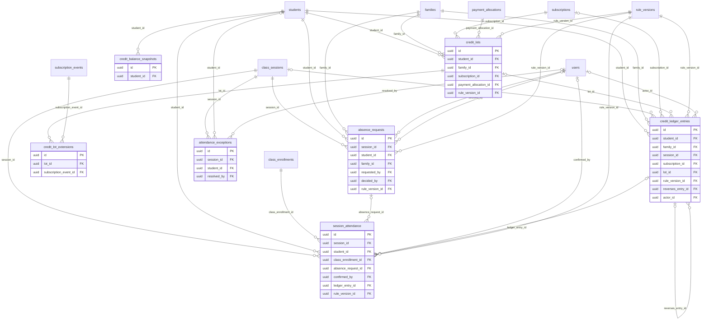

# ERD — Ledger

الحضور، وطلبات الغياب، ودفتر الرصيد للإضافة فقط (ADR-007، الدستور م5)، ودفعات الرصيد وتمديداتها (D-05)، ولقطات الرصيد، واستثناءات الحضور.

- **الرصيد:** مجموع `qty` للطالب والوعاء، يُحسب من الدفتر دائماً. اللقطات كاش يُعاد بناؤه بالجمع الكامل، ومهمة يومية تقارنها بالدفتر.
- **التصحيح:** قيد `REVERSAL` يشير إلى الأصل، ثم القيد الصحيح. لا تعديل ولا حذف، ومحفّز في قاعدة البيانات يرفضهما. إعادة قيد سبق عكسه تكون بعكس قيد العكس نفسه، فتبقى سلسلة كل قيد خطاً واحداً.
- **متى يُكتب القيد:** مرة واحدة عند إقفال الحضور، بعد تأكيد المعلمة أو الاعتماد الآلي (ATT-01، ATT-05). التغيير قبل الإقفال لا يمس الدفتر. ويؤكد ذلك WP-2.3.
- **دفعة الرصيد:** مشتقة كما في D-05 وADR-007 §5. كل حقائقها تُعاد من مصادرها:
  - الكمية وتاريخ البدء من قيد الشراء.
  - المبلغ من توزيع الدفعة.
  - المدد من إصدار القاعدة.
  - التمديد من صفوف `credit_lot_extensions`.

  تُكتب مرة واحدة، ولا يتغير فيها إلا كاش `expires_at`. وما بقي فيها مجموع قيودها في الدفتر.
- **الأقفال:** كل كتابة على رصيد طالب تأخذ قفلاً على (`student_id`، `pool`) (`pg_advisory_xact_lock`) داخل المعاملة، فلا تستهلك جلستان متزامنتان آخر حصة مرتين.
- **النصوص الحرة:** جداول الإضافة فقط هنا تحمل `reason_code`، والنص الحر في `record_notes` (Platform) القابل للمحو.

<!-- erd:diagram:start -->

<!-- erd:diagram:end -->

### `absence_requests`
- Kind: mutable · Spec: absence_requests · Reqs: ATT-02, ATT-03, PAR-05 · Scope: family_id

| Column | Type | Null | References | Notes |
| --- | --- | --- | --- | --- |
| id | uuid | no | | PK (v7) |
| session_id | uuid | no | class_sessions.id | |
| student_id | uuid | no | students.id | |
| family_id | uuid | no | families.id | |
| requested_by | uuid | no | users.id | |
| requested_at | timestamptz | no | | compared in UTC with `class_sessions.starts_at`; exactly 24 h counts as in time (ATT-02) |
| reason | text | yes | | PII |
| status | string | no | | values: submitted\|auto_accepted\|pending_review\|accepted\|rejected (spec/14) |
| within_cutoff | boolean | no | | `attendance.excuse_cutoff_hours` |
| within_cap | boolean | no | | sliding window of the last 8 scheduled sessions, `attendance.max_excused_per_8` (D-06) |
| decided_by | uuid | yes | users.id | |
| decided_at | timestamptz | yes | | |
| decision_note | text | yes | | PII |
| rule_version_id | uuid | no | rule_versions.id | |
| created_at | timestamptz | no | | |
| updated_at | timestamptz | no | | |

Constraints and indexes:
- `UNIQUE (session_id, student_id) WHERE status <> 'rejected'`

### `credit_lots`
- Kind: derived · Spec: NEW (D-05; data-model-conventions.md) · Reqs: ATT-07, BIL-07, BIL-13, BIL-14 · Scope: family_id

| Column | Type | Null | References | Notes |
| --- | --- | --- | --- | --- |
| id | uuid | no | | PK (v7) |
| student_id | uuid | no | students.id | |
| family_id | uuid | no | families.id | |
| subscription_id | uuid | no | subscriptions.id | |
| payment_allocation_id | uuid | no | payment_allocations.id | the money that funded this lot |
| cycle_no | integer | no | | 1, 2, … per subscription; a renewal can create its lot only once |
| pool | string | no | | values: paid (trial credits form no lot) |
| qty_granted | integer | no | | `plans.sessions_per_cycle` at purchase; equals the purchase entry's `qty` |
| amount_paid_minor | bigint | no | | the allocation amount for this lot (D-28 conversion base) |
| currency | char(3) | no | | |
| effective_at | timestamptz | no | | payment success (D-05) |
| cycle_end_at | timestamptz | no | | effective_at + `subscription.cycle_weeks` |
| base_expires_at | timestamptz | no | | cycle_end_at + `credits.expiry_days_after_cycle` |
| expires_at | timestamptz | no | | cache of base_expires_at + Σ (`resumed_at − frozen_from_at`) of its `credit_lot_extensions`; recomputed by an AFTER INSERT trigger on the extensions, never set by the app |
| rule_version_id | uuid | no | rule_versions.id | |
| created_at | timestamptz | no | | |
| updated_at | timestamptz | no | | |

Constraints and indexes:
- `UNIQUE (payment_allocation_id)`, `UNIQUE (subscription_id, cycle_no)`, `UNIQUE (id, student_id, pool)` (target of the ledger's composite FK)
- `CHECK (pool = 'paid')`, `CHECK (qty_granted > 0)`, `CHECK (amount_paid_minor >= 0)`
- Trigger: UPDATE may change `expires_at` and `updated_at` only, and only to the recomputed value; DELETE is rejected.
- Rebuildable: purchase entry (`qty`) + `payments.succeeded_at` (`effective_at`, D-05) + `payment_allocations.amount_minor` + order of the subscription's allocations (`cycle_no`) + `rule_versions.snapshot` + `credit_lot_extensions` (ADR-007 §5 note).
- `INDEX (student_id, pool, expires_at)`: consumption takes the lot that expires first (FIFO by `expires_at`, D-05)
- Remaining = Σ `qty` of ledger entries with this `lot_id`, the purchase included; a daily check compares it with `qty_granted` minus usage.
- Wallet conversion (D-28) = `amount_paid_minor × remaining ÷ qty_granted`, rounded once at the end (rounding rule: D-40), so the wallet never drifts from what was paid.

### `credit_lot_extensions`
- Kind: append-only · Spec: NEW (D-05 «يمدد expires_at … بمدة التجميد الفعلية»; ledger-auditor review) · Reqs: BIL-14 · Scope: via lot → family

| Column | Type | Null | References | Notes |
| --- | --- | --- | --- | --- |
| id | uuid | no | | PK (v7) |
| lot_id | uuid | no | credit_lots.id | |
| subscription_event_id | uuid | no | subscription_events.id | the `Resume` event that closed the freeze |
| frozen_from_at | timestamptz | no | | |
| resumed_at | timestamptz | no | | the extension is exactly `resumed_at − frozen_from_at` |
| created_at | timestamptz | no | | |

Constraints and indexes:
- `UNIQUE (lot_id, subscription_event_id)`: a retried Resume extends a lot once
- `CHECK (resumed_at > frozen_from_at)`

### `credit_ledger_entries`
- Kind: append-only · Spec: credit_ledger_entries · Reqs: ATT-04, ATT-05, ATT-07, ATT-08, ATT-09, ADM-09, BIL-06, BIL-12, BIL-13, PAR-07, RBAC-04 · Scope: family_id; student_id

| Column | Type | Null | References | Notes |
| --- | --- | --- | --- | --- |
| id | uuid | no | | PK (v7) |
| student_id | uuid | no | students.id | |
| family_id | uuid | no | families.id | |
| pool | string | no | | values: paid\|trial (BR-018) |
| type | string | no | | values: CREDIT_PURCHASE\|CREDIT_TRIAL\|CONSUMPTION_ATTENDANCE\|ABSENCE_UNEXCUSED\|EXTENSION_ABSENCE_EXCUSED\|COMPENSATION_ACADEMY\|ADJUSTMENT_MANUAL\|CREDIT_EXPIRY\|REVERSAL\|CONVERSION_TO_WALLET (ADR-007, D-28) |
| qty | integer | no | | signed: +8 purchase, −1 consumption, 0 excused, −original for a reversal |
| session_id | uuid | yes | class_sessions.id | |
| subscription_id | uuid | yes | subscriptions.id | |
| lot_id | uuid | yes | credit_lots.id | lot granted, consumed, expired or converted |
| rule_version_id | uuid | no | rule_versions.id | ATT-04 |
| reason_code | string | yes | | TBD(WP-2.3); required for ADJUSTMENT_MANUAL, REVERSAL, COMPENSATION_ACADEMY and a second CREDIT_TRIAL (D-29); free text goes to `record_notes` |
| reverses_entry_id | uuid | yes | credit_ledger_entries.id | |
| idempotency_key | string | no | | Art. 10; formats below |
| actor_type | string | no | | values: user\|system |
| actor_id | uuid | yes | users.id | null for system jobs |
| created_at | timestamptz | no | | |

Constraints and indexes:
- `UNIQUE (student_id, session_id, type) WHERE type IN ('CONSUMPTION_ATTENDANCE','ABSENCE_UNEXCUSED','EXTENSION_ABSENCE_EXCUSED','COMPENSATION_ACADEMY')`: the constitution's double-charge key for session entries (Art. 5 §2 «لقيود الحصص»). A REVERSAL keeps the original's `session_id` but is outside the key.
- `UNIQUE (reverses_entry_id)`: an entry is reversed at most once. A post-lock edit that must reinstate an entry already reversed (A→B→A) posts a REVERSAL of that reversal; the chain stays linear, so the net per (student, session, type) is 0 or the original `qty`, and the effective type is the chain root. A later edit always reverses the chain's **tip** (its latest entry), never the root again.
- Reversing an entry whose credit was expired at once (an `expiry:<lot_id>:<that entry>` row exists) first reverses that expiry entry, in the same transaction and under the same advisory lock; otherwise the session would be charged twice.
- In a post-lock change, the replacement entry reuses the reversed entry's lot only for the quantity the reversal freed; any extra charge (e.g. EXCUSED 0 → PRESENT −1) goes FIFO to open lots and never overdraws, and on an expired lot it is absorbed by reversing that lot's expiry entry and re-posting it one smaller (key `expiry:<lot_id>:<source_entry_id>`). Instant expiry of a returned credit is judged on the lot's net remaining after the whole transaction, so a change that keeps the session charge (e.g. PRESENT → ABSENT_UNEXCUSED) expires nothing. WP-2.3 tests the expired-lot case of every attendance mapping.
- `UNIQUE (idempotency_key)`; deterministic formats: `session:<session_id>:<student_id>:<type>`, `purchase:<payment_allocation_id>`, `trial:<trial_id>`, `expiry:<lot_id>:<source_entry_id>` (a credit returned to an already expired lot expires at once), `conversion:<lot_id>`, `reversal:<reverses_entry_id>`, `manual:<request uuid>:<lot_id>` for ADJUSTMENT_MANUAL only.
- `UNIQUE (lot_id) WHERE type = 'CREDIT_PURCHASE'`, `UNIQUE (lot_id) WHERE type = 'CONVERSION_TO_WALLET'`: one purchase and at most one wallet conversion per lot.
- Composite FK `(lot_id, student_id, pool) → credit_lots (id, student_id, pool)`: an entry can only touch its own student's paid lot.
- `CHECK (type NOT IN ('CREDIT_PURCHASE','CONVERSION_TO_WALLET') OR pool = 'paid')`, `CHECK (type <> 'CREDIT_TRIAL' OR pool = 'trial')`
- `CHECK (pool <> 'paid' OR lot_id IS NOT NULL)`: every paid-pool entry names its lot, so Σ lot remaining always equals the paid balance. COMPENSATION_ACADEMY uses the lot of the entry that charged the session; ADJUSTMENT_MANUAL −N is split across lots FIFO, one entry per lot (key `manual:<request uuid>:<lot_id>`), in one transaction, and never overdraws a lot; +N goes to the latest open lot and is rejected when no lot is open; a REVERSAL copies the original's lot.
- Sign: `CONSUMPTION_ATTENDANCE`, `ABSENCE_UNEXCUSED` = −1; `COMPENSATION_ACADEMY` = +1; `EXTENSION_ABSENCE_EXCUSED` = 0; `CREDIT_PURCHASE`, `CREDIT_TRIAL` > 0; `CREDIT_EXPIRY`, `CONVERSION_TO_WALLET` < 0; `ADJUSTMENT_MANUAL` ≠ 0.
- `CHECK ((type = 'REVERSAL') = (reverses_entry_id IS NOT NULL))`; BEFORE INSERT trigger `validate_reversal()`: `qty = −original.qty` and the same `student_id`, `pool`, `lot_id`, `session_id` as the original.
- `CHECK (type NOT IN ('ADJUSTMENT_MANUAL','REVERSAL','COMPENSATION_ACADEMY') OR reason_code IS NOT NULL)`, `CHECK (type <> 'ADJUSTMENT_MANUAL' OR (actor_type = 'user' AND actor_id IS NOT NULL))`
- `CHECK (session_id IS NOT NULL OR type NOT IN ('CONSUMPTION_ATTENDANCE','ABSENCE_UNEXCUSED','EXTENSION_ABSENCE_EXCUSED','COMPENSATION_ACADEMY'))`
- `INDEX (student_id, pool, created_at)`, `INDEX (session_id)`, `INDEX (lot_id)`
- Trigger `forbid_mutation` rejects UPDATE and DELETE for every role; `sura_app` has neither privilege (data-model-conventions.md). Rows are never deleted, also not on an erasure request: the student id becomes opaque (D-14).
- A daily reconciliation flags any (student, session) with more than one live attendance-type chain (each REVERSAL counted under its chain root's type), any student whose Σ lot remaining differs from the paid balance, and any lot whose remaining is below 0.

### `session_attendance`
- Kind: mutable · Spec: session_attendance · Reqs: ATT-01, ATT-05, TCH-05, CLS-09, RPT-01, PAR-03, ADM-09 · Scope: via session → class; student_id → family

| Column | Type | Null | References | Notes |
| --- | --- | --- | --- | --- |
| id | uuid | no | | PK (v7) |
| session_id | uuid | no | class_sessions.id | |
| student_id | uuid | no | students.id | |
| class_enrollment_id | uuid | no | class_enrollments.id | regular or trial seat (D-08) |
| suggested_status | string | yes | | values: PRESENT\|LATE\|PARTIAL\|ABSENT_EXCUSED\|ABSENT_UNEXCUSED (from participant events, CLS-09) |
| status | string | yes | | values: PRESENT\|LATE\|PARTIAL\|ABSENT_EXCUSED\|ABSENT_UNEXCUSED (confirmed) |
| first_joined_at | timestamptz | yes | | |
| last_left_at | timestamptz | yes | | |
| attended_minutes | smallint | yes | | |
| absence_request_id | uuid | yes | absence_requests.id | |
| confirmed_by | uuid | yes | users.id | teacher, within `attendance.teacher_confirm_hours` |
| confirmed_at | timestamptz | yes | | |
| auto_approved_at | timestamptz | yes | | suggestion approved after the window and flagged to the supervisor (spec/15) |
| locked_at | timestamptz | yes | | the ledger entry is posted at lock; edits after it need permission + reason + REVERSAL (ATT-05) |
| ledger_entry_id | uuid | yes | credit_ledger_entries.id | tip of the current effective chain for this student and session (the latest live entry) |
| rule_version_id | uuid | no | rule_versions.id | thresholds used for the suggestion |
| created_at | timestamptz | no | | |
| updated_at | timestamptz | no | | |

Constraints and indexes:
- `UNIQUE (session_id, student_id)`, `INDEX (student_id, session_id)`
- A post-lock change runs under `SELECT … FOR UPDATE` on this row: it reverses the tip in `ledger_entry_id` (reinstating an earlier type means reversing its reversal, not posting it again), posts the new entry when the type changes, repoints the column to the new tip and writes `audit_logs` with the reason, in one transaction.

### `credit_balance_snapshots`
- Kind: derived · Spec: credit_balance_snapshots · Reqs: ATT-07, PAR-01, PAR-07 · Scope: student_id → family

| Column | Type | Null | References | Notes |
| --- | --- | --- | --- | --- |
| id | uuid | no | | PK (v7) |
| student_id | uuid | no | students.id | |
| pool | string | no | | values: paid\|trial |
| kind | string | no | | values: current\|month_end (month-end feeds the "active students" KPI, A:27) |
| balance | integer | no | | rebuilt by a full SUM of the ledger, never incrementally (UUIDv7 order is not commit order) |
| as_of_at | timestamptz | no | | |
| created_at | timestamptz | no | | |
| updated_at | timestamptz | no | | |

Constraints and indexes:
- `UNIQUE (student_id, pool) WHERE kind = 'current'`, `UNIQUE (student_id, pool, as_of_at) WHERE kind = 'month_end'`
- A daily job compares each `current` row with the ledger sum and alerts on any difference (ADR-007).

### `attendance_exceptions`
- Kind: mutable · Spec: attendance_exceptions · Reqs: ATT-06, ADM-09, ADM-01 · Scope: via session → class

| Column | Type | Null | References | Notes |
| --- | --- | --- | --- | --- |
| id | uuid | no | | PK (v7) |
| session_id | uuid | no | class_sessions.id | |
| student_id | uuid | yes | students.id | |
| kind | string | no | | values: dispute\|conflicting_data\|late_confirmation (ATT-06) |
| status | string | no | | values: open\|resolved (proposed) |
| details | text | yes | | PII |
| resolved_by | uuid | yes | users.id | |
| resolved_at | timestamptz | yes | | |
| resolution_note | text | yes | | PII |
| created_at | timestamptz | no | | |
| updated_at | timestamptz | no | | |

Constraints and indexes:
- `INDEX (status, created_at)`
