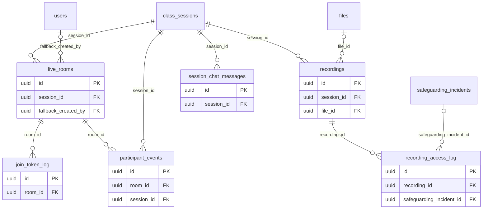

# ERD — Live

الفصل الافتراضي: غرفة لكل جلسة لدى مزود الفيديو (LiveKit خلف `VideoProvider`، ADR-005)، ورموز الدخول القصيرة، وأحداث المشاركين التي يُقترح منها الحضور (CLS-09)، والتسجيلات وسجل الوصول إليها (SEC-10)، ودردشة الحصة العامة (CLS-07).

المشارك إما مستخدم بالغ (`users`) أو طالب (`students`)، ولذلك أعمدة المشارك مورفية. هوية المشارك لدى المزود معرّفه المعتم (uuid)، واسمه الظاهر هو الاسم الأول فقط. لا تُرسل له بيانات اتصال. أما عنوان IP فيصل إلى المزود حتماً، وهذا من موضوع القرار D-35.

حذف بيانات طفل بطلب (D-14، D-11) يحذف تسجيلات الجلسات التي حضرها ضمن مدة الاحتفاظ، ويجدها عبر `session_attendance`.

<!-- erd:diagram:start -->

<!-- erd:diagram:end -->

### `live_rooms`
- Kind: mutable · Spec: live_rooms · Reqs: CLS-01, CLS-02, CLS-04, CLS-07, CLS-15, STU-04 · Scope: via session → class

| Column | Type | Null | References | Notes |
| --- | --- | --- | --- | --- |
| id | uuid | no | | PK (v7) |
| session_id | uuid | no | class_sessions.id | |
| provider | string | no | | values: livekit (ADR-005) |
| provider_room_ref | string | no | | room name at the provider |
| opens_at | timestamptz | no | | starts_at − `session.join_window_before_min` (CLS-02) |
| closes_at | timestamptz | no | | ends_at + `session.room_close_after_end_min` (05:34) |
| chat_enabled | boolean | no | | host control (CLS-07) |
| fallback_url | string | yes | | link when embedding fails (CLS-15); allow-listed to our own video project and domain, opened in child mode through an in-app route only |
| fallback_reason | text | yes | | PII |
| fallback_created_by | uuid | yes | users.id | |
| fallback_created_at | timestamptz | yes | | |
| created_at | timestamptz | no | | |
| updated_at | timestamptz | no | | |

Constraints and indexes:
- `UNIQUE (session_id)`, `UNIQUE (provider, provider_room_ref)`

### `join_token_log`
- Kind: append-only · Spec: join_token_log · Reqs: CLS-03, CLS-05, CLS-13, STU-04 · Scope: via room

| Column | Type | Null | References | Notes |
| --- | --- | --- | --- | --- |
| id | uuid | no | | PK (v7) |
| room_id | uuid | no | live_rooms.id | |
| participant_type | string | no | | values: user\|student |
| participant_id | uuid | no | | polymorphic |
| role | string | no | | values: host\|participant\|substitute\|supervisor (CLS-04, CLS-13) |
| token_hash | string | no | | hashed token id; the token itself is never stored |
| issued_at | timestamptz | no | | |
| expires_at | timestamptz | no | | short-lived (CLS-03) |
| created_at | timestamptz | no | | |

Constraints and indexes:
- `INDEX (room_id, issued_at)`, `INDEX (participant_type, participant_id)`
- Issued only to enrolled students, the planned or actual teacher, an assigned substitute and a supervisor (CLS-05).

### `participant_events`
- Kind: append-only · Spec: participant_events · Reqs: CLS-06, CLS-09, ATT-01, ADM-01 · Scope: via session → class

| Column | Type | Null | References | Notes |
| --- | --- | --- | --- | --- |
| id | uuid | no | | PK (v7) |
| room_id | uuid | no | live_rooms.id | |
| session_id | uuid | no | class_sessions.id | |
| participant_type | string | no | | values: user\|student |
| participant_id | uuid | no | | polymorphic |
| event_type | string | no | | values: joined\|left\|screen_share_started\|screen_share_stopped\|recording_started\|recording_stopped (05:33) |
| occurred_at | timestamptz | no | | provider time |
| provider_event_ref | string | yes | | deduplicates webhook deliveries |
| created_at | timestamptz | no | | |

Constraints and indexes:
- `UNIQUE (provider_event_ref) WHERE provider_event_ref IS NOT NULL`, `INDEX (session_id, participant_type, participant_id, occurred_at)`
- Kept 12 months (D-15), then deleted by `sura_retention`.

### `recordings`
- Kind: mutable · Spec: recordings · Reqs: CLS-10, SEC-10, STU-08, PAR-03, BR-014 · Scope: via session → class

| Column | Type | Null | References | Notes |
| --- | --- | --- | --- | --- |
| id | uuid | no | | PK (v7) |
| session_id | uuid | no | class_sessions.id | |
| provider_recording_ref | string | no | | |
| file_id | uuid | yes | files.id | private copy in our storage (D-16) |
| storage_region | string | no | | values: eu-central-1 (D-16) |
| copied_at | timestamptz | yes | | copy into our storage; D-16 requires it within 1 hour of availability |
| consent_snapshot | jsonb | no | | no-PII: ids only, `{student_id: consent_id}` for every student present when recording started (D-11 evidence) |
| status | string | no | | values: processing\|available\|deleted (proposed) |
| started_at | timestamptz | no | | only when every present student has a valid recording consent (D-11) |
| ended_at | timestamptz | yes | | |
| available_at | timestamptz | yes | | |
| family_visible_until_at | timestamptz | yes | | available_at + `recordings.family_days` (30) |
| delete_after_at | timestamptz | yes | | available_at + `recordings.admin_days` (90) |
| provider_deleted_at | timestamptz | yes | | deleted from the provider within 24 h (D-16) |
| deleted_at | timestamptz | yes | | storage deletion, also written to `audit_logs` (spec/15) |
| created_at | timestamptz | no | | |
| updated_at | timestamptz | no | | |

Constraints and indexes:
- `UNIQUE (provider_recording_ref)`, `INDEX (delete_after_at) WHERE deleted_at IS NULL`
- Families never download; viewing uses 10-minute signed links (`recordings.link_ttl_min`, SEC-10).

### `recording_access_log`
- Kind: append-only · Spec: recording_access_log · Reqs: SEC-10, SAFE-05, STU-08 · Scope: via recording

| Column | Type | Null | References | Notes |
| --- | --- | --- | --- | --- |
| id | uuid | no | | PK (v7) |
| recording_id | uuid | no | recordings.id | |
| viewer_type | string | no | | values: user\|student |
| viewer_id | uuid | no | | polymorphic |
| purpose | string | no | | values: family_view\|student_view\|supervisor_review\|admin |
| safeguarding_incident_id | uuid | yes | safeguarding_incidents.id | supervisor access only on a report (SAFE-05) |
| access_reason_code | string | yes | | values: retention_check\|legal_request\|technical_support (proposed; required for `admin`) |
| signed_url_expires_at | timestamptz | no | | |
| accessed_at | timestamptz | no | | |
| created_at | timestamptz | no | | |

Constraints and indexes:
- `INDEX (recording_id, accessed_at)`, `CHECK (purpose <> 'supervisor_review' OR safeguarding_incident_id IS NOT NULL)`, `CHECK (purpose <> 'admin' OR access_reason_code IS NOT NULL)`
- Kept for the audit period (2 years, F17:50).

### `session_chat_messages`
- Kind: append-only · Spec: NEW (CLS-07 «عامة فقط … ومحفوظة في السجل»; spec/14 `messages` belongs to support) · Reqs: CLS-07, SAFE-03 · Scope: via session → class

| Column | Type | Null | References | Notes |
| --- | --- | --- | --- | --- |
| id | uuid | no | | PK (v7) |
| session_id | uuid | no | class_sessions.id | |
| sender_type | string | no | | values: user\|student |
| sender_id | uuid | no | | polymorphic |
| body | text | no | | PII |
| sent_at | timestamptz | no | | |
| created_at | timestamptz | no | | |

Constraints and indexes:
- `INDEX (session_id, sent_at)`; public to the room only, no private messages (SAFE-03); never edited, so the log stays a true record; deleted after 12 months by `sura_retention` (D-15).
