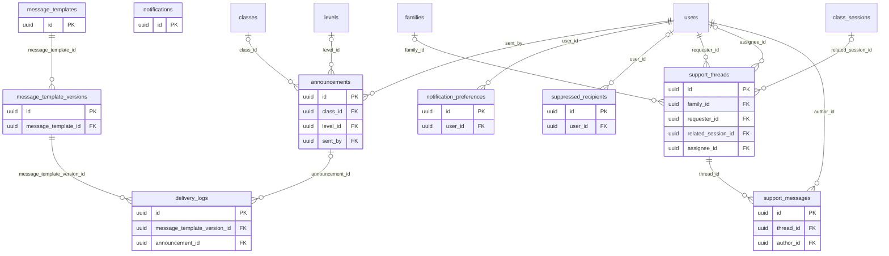

# ERD — Messaging

محرك الإشعارات بقوالب عربية وإنجليزية مرقّمة الإصدارات (NOT-07)، والإشعارات داخل التطبيق (جدول Laravel)، وسجل التسليم لكل قناة (NOT-09)، وتفضيلات المستلم وساعات الهدوء (PAR-12، D-10)، وتذاكر الدعم (MSG-01)، والإعلانات (MSG-03، NOT-08).

لا تُعرض بيانات اتصال أي طرف للآخر، ولا قناة خاصة بين بالغ وطفل (SAFE-03). القنوات في R1: البريد، والرسائل النصية للرموز والتنبيهات العاجلة، وداخل التطبيق. واتساب والإشعارات المنبثقة R2.

<!-- erd:diagram:start -->

<!-- erd:diagram:end -->

### `message_templates`
- Kind: mutable · Spec: message_templates · Reqs: NOT-01, NOT-07, ADM-11 · Scope: none (catalogue)

| Column | Type | Null | References | Notes |
| --- | --- | --- | --- | --- |
| id | uuid | no | | PK (v7) |
| key | string | no | | event key from spec/21, e.g. `payment.failed` |
| channel | string | no | | values: email\|sms\|in_app |
| priority | string | no | | values: normal\|high\|critical (spec/21: teacher emergency high, safeguarding critical) |
| bypasses_quiet_hours | boolean | no | | D-10 exceptions only |
| current_version_no | integer | yes | | published version in use |
| created_by | uuid | yes | users.id | |
| updated_by | uuid | yes | users.id | |
| created_at | timestamptz | no | | |
| updated_at | timestamptz | no | | |

Constraints and indexes:
- `UNIQUE (key, channel)`

### `message_template_versions`
- Kind: mutable · Spec: NEW (NOT-07 «إصدارات»; spec/14 «القوالب بإصدارات») · Reqs: NOT-07 · Scope: none (catalogue)

| Column | Type | Null | References | Notes |
| --- | --- | --- | --- | --- |
| id | uuid | no | | PK (v7) |
| message_template_id | uuid | no | message_templates.id | |
| version_no | integer | no | | |
| subject_ar | string | yes | | email only |
| subject_en | string | yes | | |
| body_ar | text | no | | |
| body_en | text | no | | |
| variables | jsonb | no | | allowed placeholders; child data only as the first name, never in SMS |
| published_at | timestamptz | yes | | immutable once published |
| created_by | uuid | yes | users.id | |
| created_at | timestamptz | no | | |
| updated_at | timestamptz | no | | |

Constraints and indexes:
- `UNIQUE (message_template_id, version_no)`

### `notifications`
- Kind: framework · Spec: notifications · Reqs: NOT-03, PAR-11, STU-10 · Scope: notifiable (own inbox)

| Column | Type | Null | References | Notes |
| --- | --- | --- | --- | --- |
| id | uuid | no | | PK (Laravel database notifications) |
| type | string | no | | notification class |
| notifiable_type | string | no | | `User` or `Student` (in-app reminders for the student, spec/21) |
| notifiable_id | uuid | no | | polymorphic (uuid morphs) |
| data | jsonb | no | | PII; template key, version and parameters |
| read_at | timestamptz | yes | | read state (NOT-03) |
| created_at | timestamptz | yes | | |
| updated_at | timestamptz | yes | | |

Constraints and indexes:
- `INDEX (notifiable_type, notifiable_id, read_at)`

### `announcements`
- Kind: mutable · Spec: announcements · Reqs: MSG-03, NOT-08, STU-10, ADM-11 · Scope: none (academy-issued)

| Column | Type | Null | References | Notes |
| --- | --- | --- | --- | --- |
| id | uuid | no | | PK (v7) |
| audience | string | no | | values: students\|guardians\|teachers |
| target_type | string | no | | values: all\|class\|level\|country (NOT-08) |
| class_id | uuid | yes | classes.id | |
| level_id | uuid | yes | levels.id | |
| country_code | char(2) | yes | | |
| title_ar | string | no | | |
| title_en | string | yes | | |
| body_ar | text | no | | age-appropriate wording for students (MSG-03) |
| body_en | text | yes | | |
| sent_by | uuid | no | users.id | academy staff with the bulk-message permission only (MSG-03, NOT-08) |
| published_at | timestamptz | yes | | |
| created_at | timestamptz | no | | |
| updated_at | timestamptz | no | | |

Constraints and indexes:
- `INDEX (audience, published_at)`; who received it is in `delivery_logs.announcement_id` (NOT-08 «سجل لمن أُرسلت»).

### `delivery_logs`
- Kind: append-only · Spec: delivery_logs · Reqs: NOT-01, NOT-02, NOT-04, NOT-08, NOT-09, SEC-12, ADM-11 · Scope: none (operations)

| Column | Type | Null | References | Notes |
| --- | --- | --- | --- | --- |
| id | uuid | no | | PK (v7); one row per delivery event, never updated |
| notification_ref | uuid | yes | | Laravel notification id when an in-app row exists |
| message_template_version_id | uuid | no | message_template_versions.id | |
| announcement_id | uuid | yes | announcements.id | |
| recipient_type | string | no | | values: user\|student |
| recipient_id | uuid | no | | polymorphic |
| channel | string | no | | values: email\|sms\|in_app |
| recipient_masked | string | yes | | masked address, e.g. `a***@g***.com` (SEC-12) |
| status | string | no | | values: queued\|deferred\|sent\|delivered\|bounced\|failed (NOT-09) |
| attempt_no | smallint | no | | retries (NOT-09) |
| deferred_until_at | timestamptz | yes | | 08:00 in the recipient's zone during quiet hours (D-10) |
| provider_ref | string | yes | | SES / Twilio message id |
| error_code | string | yes | | |
| occurred_at | timestamptz | no | | |
| created_at | timestamptz | no | | |

Constraints and indexes:
- `INDEX (recipient_type, recipient_id, occurred_at)`, `INDEX (provider_ref)`, `INDEX (announcement_id)`
- Kept 12 months as technical logs (F17:49).

### `notification_preferences`
- Kind: mutable · Spec: NEW (PAR-12; data-model-conventions.md) · Reqs: PAR-12, NOT-01 · Scope: user_id

| Column | Type | Null | References | Notes |
| --- | --- | --- | --- | --- |
| id | uuid | no | | PK (v7) |
| user_id | uuid | no | users.id | |
| event_category | string | no | | notification type group (PAR-12 «لكل نوع»); list TBD(WP-4.8) |
| channel | string | no | | values: email\|sms\|in_app |
| enabled | boolean | no | | security codes and safeguarding cannot be switched off (D-10) |
| quiet_hours_start | time | yes | | default from `notifications.quiet_hours` (21:00) |
| quiet_hours_end | time | yes | | default 08:00 |
| timezone | string | no | | recipient IANA zone |
| created_at | timestamptz | no | | |
| updated_at | timestamptz | no | | |

Constraints and indexes:
- `UNIQUE (user_id, event_category, channel)`

### `suppressed_recipients`
- Kind: mutable · Spec: NEW (NOT-09 «إيقاف العناوين المرتدة») · Reqs: NOT-09 · Scope: none (operations)

| Column | Type | Null | References | Notes |
| --- | --- | --- | --- | --- |
| id | uuid | no | | PK (v7) |
| channel | string | no | | values: email\|sms |
| address_hash | string | no | | hashed address; the address itself is not stored |
| reason | string | no | | values: bounce\|complaint\|manual |
| user_id | uuid | yes | users.id | |
| created_at | timestamptz | no | | |
| updated_at | timestamptz | no | | |

Constraints and indexes:
- `UNIQUE (channel, address_hash)`

### `support_threads`
- Kind: mutable · Spec: support_threads · Reqs: MSG-01, MSG-02, PAR-11, TCH-12, CLS-12 · Scope: family_id (null for a teacher's thread)

| Column | Type | Null | References | Notes |
| --- | --- | --- | --- | --- |
| id | uuid | no | | PK (v7) |
| family_id | uuid | yes | families.id | |
| requester_id | uuid | no | users.id | |
| category | string | no | | MSG-01 «تصنيف»; includes `compensation_dispute` (TCH-12) and `session_technical` (CLS-12); full list TBD(WP-4.8) |
| priority | string | no | | values: normal\|urgent (MSG-02: 1 hour for login problems before a session) |
| status | string | no | | TBD(WP-4.8) |
| related_session_id | uuid | yes | class_sessions.id | |
| assignee_id | uuid | yes | users.id | |
| sla_due_at | timestamptz | no | | 12 h first reply, 1 h when urgent (MSG-02) |
| first_response_at | timestamptz | yes | | |
| closed_at | timestamptz | yes | | |
| csat_score | smallint | yes | | MSG-01 |
| created_at | timestamptz | no | | |
| updated_at | timestamptz | no | | |

Constraints and indexes:
- `INDEX (status, sla_due_at)`, `INDEX (family_id)`; kept 12 months after closing (D-15).

### `support_messages`
- Kind: mutable · Spec: messages · Reqs: MSG-01, PAR-11 · Scope: via thread

| Column | Type | Null | References | Notes |
| --- | --- | --- | --- | --- |
| id | uuid | no | | PK (v7) |
| thread_id | uuid | no | support_threads.id | |
| author_id | uuid | no | users.id | |
| body | text | no | | PII |
| is_internal | boolean | no | | staff-only note (MSG-01) |
| created_at | timestamptz | no | | |
| updated_at | timestamptz | no | | |

Constraints and indexes:
- `INDEX (thread_id, created_at)`; attachments are `files` rows owned by the message.
