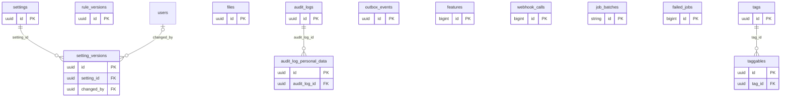

# ERD — Platform

خدمات مشتركة لكل الوحدات: الإعدادات بإصداراتها (ADM-12)، ولقطات القواعد التي يشير إليها كل قيد في الدفتر (ATT-04)، وسجل التدقيق (SEC-11، ADM-13)، والملفات المرفوعة (SEC-09)، والوسوم، وجدول الصادر (spec/15)، وأعلام الميزات (ADM-15)، والأحداث الواردة من المزودين (BIL-16). وفيها جدولا Laravel الباقيان مع Redis.

<!-- erd:diagram:start -->

<!-- erd:diagram:end -->

### `settings`
- Kind: mutable · Spec: settings · Reqs: ADM-12 · Scope: none (system configuration)

| Column | Type | Null | References | Notes |
| --- | --- | --- | --- | --- |
| id | uuid | no | | PK (v7) |
| key | string | no | | spec key verbatim, e.g. `attendance.late_after_min` (spec/21) |
| value | jsonb | no | | typed value; money as `{amount_minor, currency}` (35 JOD = 35000 fils), percentages as basis points |
| value_kind | string | no | | values: integer\|minutes\|hours\|days\|weeks\|months\|bps\|money\|time\|time_range\|currency\|list\|map |
| version_no | integer | no | | current version; history in `setting_versions` |
| description_ar | string | yes | | |
| description_en | string | yes | | |
| created_by | uuid | yes | users.id | |
| updated_by | uuid | yes | users.id | |
| created_at | timestamptz | no | | |
| updated_at | timestamptz | no | | |

Constraints and indexes:
- `UNIQUE (key)`
- Writes go through one action that also inserts the `setting_versions` row and an audit entry, in one transaction.

### `setting_versions`
- Kind: append-only · Spec: NEW (data-model-conventions.md, ADM-12 «بإصدارات ومن غيّرها ومتى») · Reqs: ADM-12 · Scope: none

| Column | Type | Null | References | Notes |
| --- | --- | --- | --- | --- |
| id | uuid | no | | PK (v7) |
| setting_id | uuid | no | settings.id | |
| version_no | integer | no | | 1, 2, … per setting |
| value | jsonb | no | | value of this version |
| effective_at | timestamptz | no | | |
| reason | text | yes | | |
| changed_by | uuid | yes | users.id | null only for the initial seed |
| created_at | timestamptz | no | | |

Constraints and indexes:
- `UNIQUE (setting_id, version_no)`

### `rule_versions`
- Kind: append-only · Spec: rule_versions · Reqs: ATT-04, ATT-07 · Scope: none

| Column | Type | Null | References | Notes |
| --- | --- | --- | --- | --- |
| id | uuid | no | | PK (v7) |
| snapshot | jsonb | no | | the `attendance.*`, `credits.*`, `subscription.*`, `billing.*`, `trial.*` and `teacher.*` setting values in force (ADR-007) |
| snapshot_hash | string | no | | sha256 of the canonical snapshot |
| created_at | timestamptz | no | | |

Constraints and indexes:
- `UNIQUE (snapshot_hash)`: one row per distinct rule set; a settings change that touches a rule key creates the next row.

### `audit_logs`
- Kind: append-only · Spec: audit_logs · Reqs: SEC-11, ADM-13, RBAC-04, RBAC-05, ADM-08, PAY-05 · Scope: none (read by system admin)

| Column | Type | Null | References | Notes |
| --- | --- | --- | --- | --- |
| id | uuid | no | | PK (v7) |
| actor_type | string | no | | values: user\|student\|system |
| actor_id | uuid | yes | | polymorphic; null for system |
| action | string | no | | dotted name, e.g. `ledger.manual_entry`, `export.revenue`, `role.revoked` |
| entity_type | string | yes | | |
| entity_id | uuid | yes | | polymorphic |
| changes | jsonb | yes | | before/after of non-personal fields only; registry columns are recorded as changed without values (D-14) |
| reason | text | yes | | written reason for sensitive actions (RBAC-04) |
| request_ref | string | yes | | the API `request_id` of the call (Art. 10) |
| occurred_at | timestamptz | no | | |
| created_at | timestamptz | no | | |

Constraints and indexes:
- `INDEX (entity_type, entity_id, occurred_at)`, `INDEX (actor_type, actor_id, occurred_at)`, `INDEX (action, occurred_at)` (ADM-13 search by user, entity, action, date)
- Kept at least 2 years, then archived (F17:50). Retention runs as `sura_retention`.

### `audit_log_personal_data`
- Kind: mutable · Spec: NEW (D-14 + SEC-11: the audit row stays immutable while its personal part stays erasable) · Reqs: SEC-11 · Scope: none

| Column | Type | Null | References | Notes |
| --- | --- | --- | --- | --- |
| id | uuid | no | | PK (v7) |
| audit_log_id | uuid | no | audit_logs.id | |
| ip | inet | yes | | PII |
| user_agent | text | yes | | PII |
| personal_changes | jsonb | yes | | PII; before/after of registry columns |
| created_at | timestamptz | no | | |
| updated_at | timestamptz | no | | |

Constraints and indexes:
- `UNIQUE (audit_log_id)`
- Deleted (never updated) on an erasure request for the subject or at the end of the audit period.

### `files`
- Kind: mutable · Spec: files · Reqs: SEC-09, HW-06, CNT-07, BIL-09, BIL-11, RPT-06, MSG-01 · Scope: via the owning record

| Column | Type | Null | References | Notes |
| --- | --- | --- | --- | --- |
| id | uuid | no | | PK (v7) |
| disk | string | no | | values: private\|public (S3 buckets; public only for site media) |
| path | string | no | | object key; PII (the object itself) |
| original_name | string | yes | | PII (names can carry a child's name) |
| mime_type | string | no | | allow-list per use (SEC-09) |
| size_bytes | bigint | no | | |
| checksum_sha256 | string | no | | |
| scan_status | string | no | | values: pending\|clean\|infected (ClamAV before availability) |
| scanned_at | timestamptz | yes | | |
| metadata_stripped_at | timestamptz | yes | | EXIF/GPS removed from images (HW-06) |
| owner_type | string | yes | | |
| owner_id | uuid | yes | | polymorphic; the record the file belongs to |
| uploader_type | string | yes | | values: user\|student\|system |
| uploader_id | uuid | yes | | polymorphic |
| delete_after_at | timestamptz | yes | | set by the retention schedule |
| created_at | timestamptz | no | | |
| updated_at | timestamptz | no | | |

Constraints and indexes:
- `UNIQUE (disk, path)`, `INDEX (owner_type, owner_id)`, `INDEX (delete_after_at) WHERE delete_after_at IS NOT NULL`
- Downloads only through signed links (SEC-09, SEC-10); no public URL is stored.

### `tags`
- Kind: mutable · Spec: NEW (ADM-02 «وسوم» on families, CNT-07 «وسوم وبحث» on media) · Reqs: ADM-02, CNT-07 · Scope: none

| Column | Type | Null | References | Notes |
| --- | --- | --- | --- | --- |
| id | uuid | no | | PK (v7) |
| domain | string | no | | values: family\|media (proposed: one tag list per use) |
| name | string | no | | |
| slug | string | no | | |
| created_by | uuid | yes | users.id | |
| updated_by | uuid | yes | users.id | |
| created_at | timestamptz | no | | |
| updated_at | timestamptz | no | | |

Constraints and indexes:
- `UNIQUE (domain, slug)`

### `taggables`
- Kind: mutable · Spec: NEW (see `tags`) · Reqs: ADM-02, CNT-07 · Scope: via the tagged record

| Column | Type | Null | References | Notes |
| --- | --- | --- | --- | --- |
| id | uuid | no | | PK (v7) |
| tag_id | uuid | no | tags.id | |
| taggable_type | string | no | | |
| taggable_id | uuid | no | | polymorphic |
| created_by | uuid | yes | users.id | |
| created_at | timestamptz | no | | |
| updated_at | timestamptz | no | | |

Constraints and indexes:
- `UNIQUE (tag_id, taggable_type, taggable_id)`, `INDEX (taggable_type, taggable_id)`

### `outbox_events`
- Kind: mutable · Spec: outbox_events · Reqs: ATT-08 · Scope: none

| Column | Type | Null | References | Notes |
| --- | --- | --- | --- | --- |
| id | uuid | no | | PK (v7); also the event id consumers deduplicate on |
| event_name | string | no | | e.g. `SessionEnded`, `PaymentSucceeded` (architecture.md §3) |
| aggregate_type | string | no | | |
| aggregate_id | uuid | no | | polymorphic |
| payload | jsonb | no | | ids and values only, no personal data |
| occurred_at | timestamptz | no | | |
| published_at | timestamptz | yes | | null until dispatched |
| attempts | smallint | no | | |
| last_error | text | yes | | |
| created_at | timestamptz | no | | |
| updated_at | timestamptz | no | | |

Constraints and indexes:
- `INDEX (occurred_at) WHERE published_at IS NULL`
- Written in the same transaction as the state change (spec/15).

### `features`
- Kind: package · Spec: feature_flags · Reqs: ADM-15 · Scope: none

| Column | Type | Null | References | Notes |
| --- | --- | --- | --- | --- |
| id | bigint | no | | PK (Laravel Pennant) |
| name | string | no | | flag name |
| scope | string | no | | serialized Pennant scope (user, family or `__laravel_null`) |
| value | text | no | | |
| created_at | timestamptz | yes | | |
| updated_at | timestamptz | yes | | |

Constraints and indexes:
- `UNIQUE (name, scope)` (Pennant)

### `webhook_calls`
- Kind: package · Spec: webhook_events · Reqs: BIL-16, CLS-09 · Scope: none

| Column | Type | Null | References | Notes |
| --- | --- | --- | --- | --- |
| id | bigint | no | | PK (spatie/laravel-webhook-client) |
| name | string | no | | provider config: `paytabs`, `livekit`, … |
| url | string | no | | |
| headers | jsonb | yes | | |
| payload | jsonb | yes | | raw event (BIL-16); PII when the provider sends contact data |
| exception | text | yes | | |
| event_ref | string | no | | added by us: the provider's event id |
| processed_at | timestamptz | yes | | added by us |
| attempts | smallint | no | | added by us; retries with backoff, then a review queue (spec/15) |
| created_at | timestamptz | yes | | |
| updated_at | timestamptz | yes | | |

Constraints and indexes:
- `UNIQUE (name, event_ref)`: a duplicate delivery is stored once and processed once (spec/15 «كل حدث خارجي يُعالج مرة واحدة فقط»)
- Only events with a valid signature are stored.

### `job_batches`
- Kind: framework · Spec: NEW (Laravel queue batching; queues run on Redis) · Reqs: — · Scope: none

| Column | Type | Null | References | Notes |
| --- | --- | --- | --- | --- |
| id | string | no | | PK |
| name | string | no | | |
| total_jobs | integer | no | | |
| pending_jobs | integer | no | | |
| failed_jobs | integer | no | | |
| failed_job_ids | text | no | | |
| options | text | yes | | |
| cancelled_at | integer | yes | | Laravel stores Unix seconds here |
| created_at | integer | no | | Unix seconds |
| finished_at | integer | yes | | Unix seconds |

### `failed_jobs`
- Kind: framework · Spec: NEW (Laravel `database-uuids` failed-job store) · Reqs: — · Scope: none

| Column | Type | Null | References | Notes |
| --- | --- | --- | --- | --- |
| id | bigint | no | | PK |
| uuid | string | no | | |
| connection | text | no | | |
| queue | text | no | | |
| payload | text | no | | jobs carry ids only, never personal data (Art. 8) |
| exception | text | no | | |
| failed_at | timestamptz | no | | |

Constraints and indexes:
- `UNIQUE (uuid)`
- `cache`, `cache_locks` and `jobs` are not created: cache and queues use Redis (`CACHE_STORE=redis`, `QUEUE_CONNECTION=redis`).
