# ERD — Scheduling

الشعب ومواعيدها، والتسجيل فيها، والجلسات، والتغييرات، والعطل، وتوفر المعلمات وإجازاتهن، وطلبات التغيير، وقائمة الانتظار، وحجز المقعد.

نموذج الوقت (ADR-008، الدستور م6):
- كل لحظة `timestamptz` بالتوقيت العالمي.
- نمط الشعبة يوم في الأسبوع وساعة محلية مع منطقة IANA مرجعية (`ref_timezone`).
- الجلسات تُولَّد من النمط ثمانية أسابيع مقدماً (`scheduling.generate_weeks_ahead`).
- الساعة غير الموجودة أو المكررة عند تحول التوقيت تُعلَّم «تحتاج مراجعة» ولا يُختار وقت ضمنياً.
- أوقات تفضيل الطالب بالطريقة نفسها: يوم وساعة محلية ومنطقة الأسرة (D-37).

```mermaid
erDiagram
  classes {
    uuid id PK
    uuid level_id FK
    uuid teacher_id FK
    uuid capacity_override_by FK
  }
  class_schedule_rules {
    uuid id PK
    uuid class_id FK
  }
  seat_holds {
    uuid id PK
    uuid class_id FK
    uuid student_id FK
    uuid family_id FK
  }
  class_enrollments {
    uuid id PK
    uuid class_id FK
    uuid student_id FK
    uuid family_id FK
    uuid seat_hold_id FK
    uuid transferred_to_enrollment_id FK
    uuid dst_mismatch_confirmed_by FK
  }
  enrollment_history {
    uuid id PK
    uuid class_enrollment_id FK
    uuid student_id FK
    uuid actor_id FK
  }
  class_sessions {
    uuid id PK
    uuid class_id FK
    uuid schedule_rule_id FK
    uuid teacher_id FK
    uuid actual_teacher_id FK
    uuid replaces_session_id FK
    uuid lesson_id FK
  }
  session_changes {
    uuid id PK
    uuid session_id FK
    uuid old_teacher_id FK
    uuid new_teacher_id FK
    uuid calendar_exception_id FK
    uuid actor_id FK
  }
  calendar_exceptions {
    uuid id PK
    uuid confirmed_by FK
  }
  teacher_availability {
    uuid id PK
    uuid teacher_id FK
  }
  teacher_leaves {
    uuid id PK
    uuid teacher_id FK
    uuid decided_by FK
  }
  change_requests {
    uuid id PK
    uuid requester_id FK
    uuid family_id FK
    uuid student_id FK
    uuid class_id FK
    uuid session_id FK
    uuid decided_by FK
  }
  waitlist_entries {
    uuid id PK
    uuid family_id FK
    uuid student_id FK
    uuid lead_id FK
    uuid level_id FK
    uuid class_id FK
    uuid seat_hold_id FK
  }
  student_availability {
    uuid id PK
    uuid student_id FK
    uuid family_id FK
  }
  levels ||--o{ classes : "level_id"
  teachers ||--o{ classes : "teacher_id"
  users |o--o{ classes : "capacity_override_by"
  classes ||--o{ class_schedule_rules : "class_id"
  classes ||--o{ seat_holds : "class_id"
  students ||--o{ seat_holds : "student_id"
  families ||--o{ seat_holds : "family_id"
  classes ||--o{ class_enrollments : "class_id"
  students ||--o{ class_enrollments : "student_id"
  families ||--o{ class_enrollments : "family_id"
  seat_holds |o--o{ class_enrollments : "seat_hold_id"
  class_enrollments |o--o{ class_enrollments : "transferred_to_enrollment_id"
  users |o--o{ class_enrollments : "dst_mismatch_confirmed_by"
  class_enrollments ||--o{ enrollment_history : "class_enrollment_id"
  students ||--o{ enrollment_history : "student_id"
  users |o--o{ enrollment_history : "actor_id"
  classes ||--o{ class_sessions : "class_id"
  class_schedule_rules |o--o{ class_sessions : "schedule_rule_id"
  teachers ||--o{ class_sessions : "teacher_id"
  teachers |o--o{ class_sessions : "actual_teacher_id"
  class_sessions |o--o{ class_sessions : "replaces_session_id"
  lessons |o--o{ class_sessions : "lesson_id"
  class_sessions ||--o{ session_changes : "session_id"
  teachers |o--o{ session_changes : "old_teacher_id"
  teachers |o--o{ session_changes : "new_teacher_id"
  calendar_exceptions |o--o{ session_changes : "calendar_exception_id"
  users |o--o{ session_changes : "actor_id"
  users |o--o{ calendar_exceptions : "confirmed_by"
  teachers ||--o{ teacher_availability : "teacher_id"
  teachers ||--o{ teacher_leaves : "teacher_id"
  users |o--o{ teacher_leaves : "decided_by"
  users ||--o{ change_requests : "requester_id"
  families |o--o{ change_requests : "family_id"
  students |o--o{ change_requests : "student_id"
  classes |o--o{ change_requests : "class_id"
  class_sessions |o--o{ change_requests : "session_id"
  users |o--o{ change_requests : "decided_by"
  families |o--o{ waitlist_entries : "family_id"
  students |o--o{ waitlist_entries : "student_id"
  leads |o--o{ waitlist_entries : "lead_id"
  levels |o--o{ waitlist_entries : "level_id"
  classes |o--o{ waitlist_entries : "class_id"
  seat_holds |o--o{ waitlist_entries : "seat_hold_id"
  students ||--o{ student_availability : "student_id"
  families ||--o{ student_availability : "family_id"
```

<!-- erd:diagram:start -->

<!-- erd:diagram:end -->

### `classes`
- Kind: mutable · Spec: classes · Reqs: SCH-01, SCH-02, SCH-03, SCH-16, PUB-04, ADM-05, TOP-05 · Scope: class_id (self)

| Column | Type | Null | References | Notes |
| --- | --- | --- | --- | --- |
| id | uuid | no | | PK (v7); model `ClassGroup` |
| code | string | no | | |
| level_id | uuid | no | levels.id | |
| teacher_id | uuid | no | teachers.id | assigned teacher |
| age_min | smallint | no | | SCH-01 |
| age_max | smallint | no | | |
| capacity | smallint | no | | between `class.capacity_min` and `class.capacity_max` (2–4) unless overridden |
| capacity_override_reason | text | yes | | PII; supervisor permission + reason (SCH-01) |
| capacity_override_by | uuid | yes | users.id | |
| session_minutes | smallint | no | | from `session.duration_by_age` when created (SCH-16) |
| ref_timezone | string | no | | IANA reference zone of most target families (ADR-008 §2) |
| status | string | no | | values: draft\|open\|active\|suspended\|completed (SCH-02, state-machines.md) |
| status_reason | text | yes | | PII; required for `suspended` |
| starts_on | date | no | | |
| published_at | timestamptz | yes | | listed on the public schedule while `open` (PUB-04) |
| created_by | uuid | yes | users.id | |
| updated_by | uuid | yes | users.id | |
| archived_at | timestamptz | yes | | |
| created_at | timestamptz | no | | |
| updated_at | timestamptz | no | | |

Constraints and indexes:
- `UNIQUE (code)`, `INDEX (status, level_id)`, `INDEX (teacher_id)`
- `CHECK (age_min <= age_max)`, `CHECK (capacity_override_reason IS NOT NULL OR capacity BETWEEN 2 AND 4)` is enforced in the action from settings, not as a literal CHECK (Art. 5 §8).

### `class_schedule_rules`
- Kind: mutable · Spec: class_schedule_rules · Reqs: SCH-01, SCH-05, SCH-09 · Scope: class_id

| Column | Type | Null | References | Notes |
| --- | --- | --- | --- | --- |
| id | uuid | no | | PK (v7) |
| class_id | uuid | no | classes.id | |
| weekday | smallint | no | | ISO 1 (Monday) … 7 |
| local_start | time | no | | local time in `ref_timezone` |
| duration_minutes | smallint | no | | |
| ref_timezone | string | no | | IANA; equals the class zone |
| valid_from_on | date | no | | a pattern change "going forward" closes this rule and opens a new one (SCH-09) |
| valid_to_on | date | yes | | |
| generated_through_on | date | yes | | rolling horizon reached by generation (SCH-05) |
| created_by | uuid | yes | users.id | |
| updated_by | uuid | yes | users.id | |
| created_at | timestamptz | no | | |
| updated_at | timestamptz | no | | |

Constraints and indexes:
- `CHECK (weekday BETWEEN 1 AND 7)`, `INDEX (class_id, valid_from_on)`

### `seat_holds`
- Kind: mutable · Spec: NEW (D-30; data-model-conventions.md) · Reqs: SCH-04, ONB-08, ONB-10 · Scope: family_id

| Column | Type | Null | References | Notes |
| --- | --- | --- | --- | --- |
| id | uuid | no | | PK (v7) |
| class_id | uuid | no | classes.id | |
| student_id | uuid | no | students.id | |
| family_id | uuid | no | families.id | |
| reason | string | no | | no-PII: fixed values; values: payment\|waitlist_offer (D-30 15 minutes; waitlist invitation 48 hours, 08:32) |
| expires_at | timestamptz | no | | |
| released_at | timestamptz | yes | | expired or cancelled |
| converted_at | timestamptz | yes | | became an enrollment |
| created_by | uuid | yes | users.id | |
| created_at | timestamptz | no | | |
| updated_at | timestamptz | no | | |

Constraints and indexes:
- `UNIQUE (class_id, student_id) WHERE released_at IS NULL AND converted_at IS NULL`
- Seats taken = active and pending enrollments + live holds; the count never exceeds `classes.capacity` (checked under a row lock on the class).

### `class_enrollments`
- Kind: mutable · Spec: class_enrollments · Reqs: SCH-03, SCH-07, SCH-14, ONB-08, CLS-05, ATT-09, PAR-01 · Scope: class_id, family_id

| Column | Type | Null | References | Notes |
| --- | --- | --- | --- | --- |
| id | uuid | no | | PK (v7) |
| class_id | uuid | no | classes.id | |
| student_id | uuid | no | students.id | |
| family_id | uuid | no | families.id | |
| kind | string | no | | values: regular\|trial (D-08) |
| status | string | no | | values: pending\|active\|paused\|transferred\|ended (state-machines.md) |
| seat_hold_id | uuid | yes | seat_holds.id | |
| starts_on | date | no | | |
| ended_on | date | yes | | |
| transferred_to_enrollment_id | uuid | yes | class_enrollments.id | SCH-14; attendance and credit history stay with the student |
| dst_mismatch_confirmed_by | uuid | yes | users.id | explicit confirmation when the family's DST regime differs from the class (SCH-07) |
| dst_mismatch_confirmed_at | timestamptz | yes | | |
| created_by | uuid | yes | users.id | |
| updated_by | uuid | yes | users.id | |
| created_at | timestamptz | no | | |
| updated_at | timestamptz | no | | |

Constraints and indexes:
- `UNIQUE (class_id, student_id) WHERE status IN ('pending','active','paused')`, `INDEX (student_id, status)`
- Every status change writes `enrollment_history` in the same transaction.

### `enrollment_history`
- Kind: append-only · Spec: enrollment_history · Reqs: SCH-14, PAR-03, ADM-03 · Scope: student_id → family

| Column | Type | Null | References | Notes |
| --- | --- | --- | --- | --- |
| id | uuid | no | | PK (v7) |
| class_enrollment_id | uuid | no | class_enrollments.id | |
| student_id | uuid | no | students.id | |
| from_state | string | yes | | null for creation; enrollment status values |
| to_state | string | no | | enrollment status values |
| actor_id | uuid | yes | users.id | null for system jobs |
| reason_code | string | yes | | TBD(WP-2.2); free text goes to `record_notes` |
| occurred_at | timestamptz | no | | |
| created_at | timestamptz | no | | |

Constraints and indexes:
- `INDEX (student_id, occurred_at)`

### `class_sessions`
- Kind: mutable · Spec: sessions · Reqs: SCH-05, SCH-06, SCH-08, SCH-09, SCH-10, SCH-12, ATT-01, ATT-08, ATT-09, TCH-05, TCH-06, CLS-02, CLS-11, CLS-13, ADM-01 · Scope: class_id

| Column | Type | Null | References | Notes |
| --- | --- | --- | --- | --- |
| id | uuid | no | | PK (v7); model `ClassSession`, foreign keys elsewhere are `session_id` |
| class_id | uuid | no | classes.id | |
| schedule_rule_id | uuid | yes | class_schedule_rules.id | null for a one-off or makeup session |
| starts_at | timestamptz | no | | spec `starts_at_utc` |
| ends_at | timestamptz | no | | spec `ends_at_utc` |
| local_start_on | date | no | | local date in `ref_timezone` (spec `local_start`) |
| local_start_time | time | no | | |
| ref_timezone | string | no | | IANA (spec `ref_timezone`) |
| type | string | no | | values: regular\|trial\|makeup (spec «عادية، تجريبية، بديلة»; `trial` reserved for trial-only sessions, D-08) |
| status | string | no | | values: scheduled\|in_progress\|completed\|cancelled\|postponed (state-machines.md) |
| outcome | string | yes | | values: HELD\|HELD_NO_SHOW\|CANCELLED_TEACHER\|CANCELLED_HOLIDAY\|POSTPONED_GROUP\|TECH_FAILURE (spec/09) |
| teacher_id | uuid | no | teachers.id | planned teacher |
| actual_teacher_id | uuid | yes | teachers.id | who taught; drives pay (PAY-01) |
| actual_started_at | timestamptz | yes | | teacher's first entry; 5 minutes late alerts operations (05:31) |
| actual_ended_at | timestamptz | yes | | |
| replaces_session_id | uuid | yes | class_sessions.id | makeup for a postponed or cancelled session (state-machines.md, SCH-12) |
| needs_review_reason | string | yes | | no-PII: fixed values; values: dst_gap\|dst_overlap (ADR-008 §4) |
| maintenance_override_reason | text | yes | | PII; D-24 supervisor override |
| recording_blocked_reason | string | yes | | no-PII: fixed values; values: missing_consent (D-11) |
| lesson_id | uuid | yes | lessons.id | curriculum progress (TCH-06) |
| teacher_notes | text | yes | | PII; session notes (CLS-11) |
| attendance_locked_at | timestamptz | yes | | after `attendance.teacher_confirm_hours`; later edits need ATT-05 |
| ledger_processed_at | timestamptz | yes | | ledger entries posted, once, at attendance lock (ATT-08; name used by WP-2.3) |
| dst_notice_sent_at | timestamptz | yes | | SCH-06 |
| created_by | uuid | yes | users.id | |
| updated_by | uuid | yes | users.id | |
| created_at | timestamptz | no | | |
| updated_at | timestamptz | no | | |

Constraints and indexes:
- No overlap for one teacher: `EXCLUDE USING gist (COALESCE(actual_teacher_id, teacher_id) WITH =, tstzrange(starts_at, ends_at) WITH &&) WHERE status NOT IN ('cancelled','postponed')` (spec/14)
- `UNIQUE (class_id, starts_at) WHERE status <> 'cancelled'`, `INDEX (starts_at)`, `INDEX (status, starts_at)`
- `CHECK ((status IN ('completed','cancelled','postponed')) = (outcome IS NOT NULL))`, `CHECK ((outcome = 'POSTPONED_GROUP') = (status = 'postponed'))`; an outcome change after `ledger_processed_at` goes through one action that posts reversals and compensation.
- The live room is 1:1 through `live_rooms.session_id` (spec field `live_room_id` is not duplicated here).

### `session_changes`
- Kind: mutable · Spec: session_changes · Reqs: SCH-09, SCH-10, SCH-12, TCH-02 · Scope: via session → class

| Column | Type | Null | References | Notes |
| --- | --- | --- | --- | --- |
| id | uuid | no | | PK (v7) |
| session_id | uuid | no | class_sessions.id | |
| change_kind | string | no | | values: reschedule\|cancel\|postpone\|teacher_change |
| scope | string | no | | values: single\|pattern_forward (SCH-09) |
| reason_code | string | yes | | values: teacher_absence\|holiday\|technical\|group_postponement (SCH-10) |
| reason_note | text | yes | | PII |
| old_starts_at | timestamptz | yes | | |
| new_starts_at | timestamptz | yes | | |
| old_teacher_id | uuid | yes | teachers.id | |
| new_teacher_id | uuid | yes | teachers.id | |
| calendar_exception_id | uuid | yes | calendar_exceptions.id | holiday mass cancel (SCH-12) |
| actor_id | uuid | yes | users.id | |
| created_at | timestamptz | no | | |
| updated_at | timestamptz | no | | |

Constraints and indexes:
- `INDEX (session_id, created_at)`

### `calendar_exceptions`
- Kind: mutable · Spec: calendar_exceptions · Reqs: SCH-12, ADM-05 · Scope: none (all classes)

| Column | Type | Null | References | Notes |
| --- | --- | --- | --- | --- |
| id | uuid | no | | PK (v7) |
| name_ar | string | no | | |
| name_en | string | no | | |
| kind | string | no | | values: jordan_public_holiday\|religious_holiday\|academy_break (SCH-12) |
| starts_on | date | no | | dates in `Asia/Amman` |
| ends_on | date | no | | |
| status | string | no | | values: tentative\|confirmed (D-12) |
| confirmed_at | timestamptz | yes | | confirmation runs the mass cancel and makeups |
| confirmed_by | uuid | yes | users.id | |
| created_by | uuid | yes | users.id | |
| updated_by | uuid | yes | users.id | |
| created_at | timestamptz | no | | |
| updated_at | timestamptz | no | | |

Constraints and indexes:
- `CHECK (starts_on <= ends_on)`, `INDEX (starts_on)`

Defined before `session_changes` in the migration order.

### `teacher_availability`
- Kind: mutable · Spec: teacher_availability · Reqs: TCH-09, SCH-08, SCH-11 · Scope: teacher_id

| Column | Type | Null | References | Notes |
| --- | --- | --- | --- | --- |
| id | uuid | no | | PK (v7) |
| teacher_id | uuid | no | teachers.id | |
| weekday | smallint | no | | ISO 1 … 7 |
| local_start | time | no | | |
| local_end | time | no | | |
| ref_timezone | string | no | | `Asia/Amman` (entered in Amman time, TCH-09) |
| valid_from_on | date | no | | |
| valid_to_on | date | yes | | |
| created_at | timestamptz | no | | |
| updated_at | timestamptz | no | | |

Constraints and indexes:
- `INDEX (teacher_id, weekday)`

### `teacher_leaves`
- Kind: mutable · Spec: teacher_leaves · Reqs: TCH-09, TCH-10, SCH-11 · Scope: teacher_id

| Column | Type | Null | References | Notes |
| --- | --- | --- | --- | --- |
| id | uuid | no | | PK (v7) |
| teacher_id | uuid | no | teachers.id | |
| kind | string | no | | values: planned\|emergency (TCH-09, TCH-10) |
| starts_at | timestamptz | no | | |
| ends_at | timestamptz | no | | |
| status | string | no | | values: requested\|approved\|rejected (proposed; TCH-09 needs admin approval; emergency reports alert operations at once) |
| reason | text | yes | | PII (may hold health details) |
| decided_by | uuid | yes | users.id | |
| decided_at | timestamptz | yes | | |
| created_at | timestamptz | no | | |
| updated_at | timestamptz | no | | |

Constraints and indexes:
- `INDEX (teacher_id, starts_at)`

### `change_requests`
- Kind: mutable · Spec: change_requests · Reqs: PAR-06, TCH-11 · Scope: family_id or teacher (requester)

| Column | Type | Null | References | Notes |
| --- | --- | --- | --- | --- |
| id | uuid | no | | PK (v7); model `ScheduleChangeRequest` |
| requester_id | uuid | no | users.id | |
| requester_role | string | no | | values: guardian\|teacher |
| family_id | uuid | yes | families.id | |
| student_id | uuid | yes | students.id | |
| class_id | uuid | yes | classes.id | |
| session_id | uuid | yes | class_sessions.id | |
| request_type | string | no | | values: session_time\|class_change\|pattern (proposed) |
| details | text | yes | | PII |
| status | string | no | | values: open\|approved\|rejected\|withdrawn (proposed; a request never changes the schedule by itself, TCH-11) |
| decided_by | uuid | yes | users.id | |
| decided_at | timestamptz | yes | | |
| decision_note | text | yes | | PII |
| created_at | timestamptz | no | | |
| updated_at | timestamptz | no | | |

Constraints and indexes:
- `INDEX (status, created_at)`, `INDEX (family_id)`

### `waitlist_entries`
- Kind: mutable · Spec: waitlist_entries · Reqs: SCH-04, PUB-08, ONB-08, ADM-05 · Scope: family_id (null for a visitor lead)

| Column | Type | Null | References | Notes |
| --- | --- | --- | --- | --- |
| id | uuid | no | | PK (v7) |
| family_id | uuid | yes | families.id | |
| student_id | uuid | yes | students.id | |
| lead_id | uuid | yes | leads.id | visitor waitlist (PUB-08) |
| level_id | uuid | yes | levels.id | |
| class_id | uuid | yes | classes.id | waiting for a specific full class (ONB-08) |
| child_age | smallint | yes | | PII; visitor form only, when no student exists; deleted with the lead |
| preferred_windows | jsonb | yes | | `[{weekday, local_start, local_end, timezone}]` for leads (D-37 format); families use `student_availability` |
| status | string | no | | values: waiting\|offered\|placed\|withdrawn\|expired (proposed) |
| seat_hold_id | uuid | yes | seat_holds.id | 48-hour reserved seat in the invitation (08:32) |
| offered_at | timestamptz | yes | | |
| created_at | timestamptz | no | | |
| updated_at | timestamptz | no | | |

Constraints and indexes:
- `CHECK (num_nonnulls(family_id, lead_id) >= 1)`, `INDEX (status, level_id)`; the daily match alerts operations at `waitlist.open_class_threshold` (3) compatible entries.

### `student_availability`
- Kind: mutable · Spec: student_availability · Reqs: ONB-13, SCH-08, SCH-04 · Scope: family_id

| Column | Type | Null | References | Notes |
| --- | --- | --- | --- | --- |
| id | uuid | no | | PK (v7) |
| student_id | uuid | no | students.id | |
| family_id | uuid | no | families.id | |
| weekday | smallint | no | | ISO 1 … 7 |
| local_start | time | no | | |
| local_end | time | no | | |
| timezone | string | no | | the family's IANA zone (D-37 option a); UTC is computed when matching |
| created_at | timestamptz | no | | |
| updated_at | timestamptz | no | | |

Constraints and indexes:
- `INDEX (student_id)`; asked only for the waitlist and special cases (ONB-13).
