# ERD — Teachers

المعلمات من التقدم إلى التفعيل، والمستويات المؤهلات لها، والوثائق، والتدريب، والملاحظة، والمستحقات الشهرية بالفلس (JOD × 1000).

حالات المعلمة في `spec/14` موزعة على جدولين:
- `teacher_applications`: من التقدم إلى القبول (متقدمة ← مقبولة في الفرز ← مُقابَلة).
- `teachers`: بعد القبول (في التدريب ← تحت المراقبة ← نشطة ← موقوفة أو منتهية).

التفعيل يتطلب شهادة عدم المحكومية وتدريب الحماية والإقرار بمدونة السلوك (SAFE-04). الإقرار صف في `consents`.

```mermaid
erDiagram
  teachers {
    uuid id PK
    uuid user_id FK
  }
  teacher_levels {
    uuid id PK
    uuid teacher_id FK
    uuid level_id FK
  }
  teacher_bank_accounts {
    uuid id PK
    uuid teacher_id FK
  }
  teacher_applications {
    uuid id PK
    uuid cv_file_id FK
    uuid screened_by FK
    uuid teacher_id FK
  }
  teacher_interviews {
    uuid id PK
    uuid teacher_application_id FK
    uuid interviewer_id FK
  }
  teacher_documents {
    uuid id PK
    uuid teacher_id FK
    uuid file_id FK
    uuid verified_by FK
  }
  trainings {
    uuid id PK
  }
  training_completions {
    uuid id PK
    uuid teacher_id FK
    uuid training_id FK
    uuid evidence_file_id FK
    uuid recorded_by FK
  }
  observations {
    uuid id PK
    uuid teacher_id FK
    uuid observer_id FK
    uuid session_id FK
  }
  compensation_rules {
    uuid id PK
    uuid teacher_id FK
    uuid class_id FK
  }
  compensation_statements {
    uuid id PK
    uuid teacher_id FK
    uuid approved_by FK
  }
  compensation_lines {
    uuid id PK
    uuid teacher_id FK
    uuid statement_id FK
    uuid session_id FK
    uuid rule_version_id FK
    uuid compensation_rule_id FK
    uuid approved_by FK
  }
  payouts {
    uuid id PK
    uuid statement_id FK
    uuid teacher_id FK
    uuid export_file_id FK
    uuid recorded_by FK
  }
  users ||--o{ teachers : "user_id"
  teachers ||--o{ teacher_levels : "teacher_id"
  levels ||--o{ teacher_levels : "level_id"
  teachers ||--o{ teacher_bank_accounts : "teacher_id"
  files |o--o{ teacher_applications : "cv_file_id"
  users |o--o{ teacher_applications : "screened_by"
  teachers |o--o{ teacher_applications : "teacher_id"
  teacher_applications ||--o{ teacher_interviews : "teacher_application_id"
  users ||--o{ teacher_interviews : "interviewer_id"
  teachers ||--o{ teacher_documents : "teacher_id"
  files ||--o{ teacher_documents : "file_id"
  users |o--o{ teacher_documents : "verified_by"
  teachers ||--o{ training_completions : "teacher_id"
  trainings ||--o{ training_completions : "training_id"
  files |o--o{ training_completions : "evidence_file_id"
  users |o--o{ training_completions : "recorded_by"
  teachers ||--o{ observations : "teacher_id"
  users ||--o{ observations : "observer_id"
  class_sessions |o--o{ observations : "session_id"
  teachers |o--o{ compensation_rules : "teacher_id"
  classes |o--o{ compensation_rules : "class_id"
  teachers ||--o{ compensation_statements : "teacher_id"
  users |o--o{ compensation_statements : "approved_by"
  teachers ||--o{ compensation_lines : "teacher_id"
  compensation_statements |o--o{ compensation_lines : "statement_id"
  class_sessions |o--o{ compensation_lines : "session_id"
  rule_versions ||--o{ compensation_lines : "rule_version_id"
  compensation_rules |o--o{ compensation_lines : "compensation_rule_id"
  users |o--o{ compensation_lines : "approved_by"
  compensation_statements ||--o{ payouts : "statement_id"
  teachers ||--o{ payouts : "teacher_id"
  files |o--o{ payouts : "export_file_id"
  users |o--o{ payouts : "recorded_by"
```

<!-- erd:diagram:start -->

<!-- erd:diagram:end -->

### `teachers`
- Kind: mutable · Spec: teachers · Reqs: TOP-01, TOP-02, TOP-05, SAFE-04, SAFE-06, ADM-04, RBAC-02 · Scope: teacher_id (self)

| Column | Type | Null | References | Notes |
| --- | --- | --- | --- | --- |
| id | uuid | no | | PK (v7) |
| user_id | uuid | no | users.id | name and contact data live on `users`; display in `Asia/Amman` (TCH-01) |
| status | string | no | | values: in_training\|probation\|active\|suspended\|terminated (spec/14) |
| languages | jsonb | yes | | ISO 639-1 list (TOP-02) |
| qualifications | text | yes | | PII (TOP-02) |
| max_classes | smallint | no | | TOP-02 |
| activated_at | timestamptz | yes | | only after the SAFE-04 checks pass |
| suspended_at | timestamptz | yes | | immediate suspension blocks new assignments and session entry (TOP-05, SAFE-06) |
| terminated_at | timestamptz | yes | | |
| status_reason | text | yes | | written reason for suspension or termination |
| created_by | uuid | yes | users.id | |
| updated_by | uuid | yes | users.id | |
| archived_at | timestamptz | yes | | |
| created_at | timestamptz | no | | |
| updated_at | timestamptz | no | | |

Constraints and indexes:
- `UNIQUE (user_id)`, `INDEX (status)`

### `teacher_levels`
- Kind: mutable · Spec: NEW (TOP-02 «المستويات المؤهلة لها», SCH-11 substitutes «المؤهلات للمستوى») · Reqs: TOP-02, SCH-11 · Scope: teacher_id

| Column | Type | Null | References | Notes |
| --- | --- | --- | --- | --- |
| id | uuid | no | | PK (v7) |
| teacher_id | uuid | no | teachers.id | |
| level_id | uuid | no | levels.id | |
| created_by | uuid | yes | users.id | |
| created_at | timestamptz | no | | |
| updated_at | timestamptz | no | | |

Constraints and indexes:
- `UNIQUE (teacher_id, level_id)`, `INDEX (level_id)`

### `teacher_bank_accounts`
- Kind: mutable · Spec: NEW (TOP-02 «البيانات البنكية مشفرة», SEC-08 field encryption; kept apart so it can be erased) · Reqs: TOP-02, SEC-08, PAY-06 · Scope: teacher_id (finance only)

| Column | Type | Null | References | Notes |
| --- | --- | --- | --- | --- |
| id | uuid | no | | PK (v7) |
| teacher_id | uuid | no | teachers.id | |
| account_holder_name | text | no | | PII; encrypted |
| iban | text | yes | | PII; encrypted |
| cliq_alias | text | yes | | PII; encrypted (CliQ payouts, 16:33) |
| bank_name | string | yes | | |
| verified_at | timestamptz | yes | | |
| created_by | uuid | yes | users.id | |
| updated_by | uuid | yes | users.id | |
| created_at | timestamptz | no | | |
| updated_at | timestamptz | no | | |

Constraints and indexes:
- `UNIQUE (teacher_id)`, `CHECK (num_nonnulls(iban, cliq_alias) >= 1)`

### `teacher_applications`
- Kind: mutable · Spec: teacher_applications · Reqs: PUB-09, TOP-01 · Scope: none (recruitment staff)

| Column | Type | Null | References | Notes |
| --- | --- | --- | --- | --- |
| id | uuid | no | | PK (v7) |
| applicant_name | string | no | | PII |
| email | string | no | | PII |
| phone_e164 | string | yes | | PII |
| country_code | char(2) | yes | | |
| cv_file_id | uuid | yes | files.id | |
| cover_note | text | yes | | PII |
| status | string | no | | values: applied\|screened\|interviewed\|accepted\|rejected\|withdrawn (spec/14 first steps; proposed split) |
| screened_by | uuid | yes | users.id | |
| screened_at | timestamptz | yes | | |
| decided_at | timestamptz | yes | | |
| teacher_id | uuid | yes | teachers.id | set on acceptance |
| created_at | timestamptz | no | | |
| updated_at | timestamptz | no | | |

Constraints and indexes:
- `INDEX (status, created_at)`, `UNIQUE (teacher_id) WHERE teacher_id IS NOT NULL`

### `teacher_interviews`
- Kind: mutable · Spec: NEW (TOP-01 «مقابلة بنموذج تقييم») · Reqs: TOP-01 · Scope: none (recruitment staff)

| Column | Type | Null | References | Notes |
| --- | --- | --- | --- | --- |
| id | uuid | no | | PK (v7) |
| teacher_application_id | uuid | no | teacher_applications.id | |
| interviewer_id | uuid | no | users.id | |
| scheduled_at | timestamptz | no | | |
| scores | jsonb | yes | | the scoring form as filled; criteria TBD in WP-2.6 |
| recommendation | text | yes | | PII |
| decision | string | yes | | values: advance\|reject\|hold (proposed) |
| completed_at | timestamptz | yes | | |
| created_at | timestamptz | no | | |
| updated_at | timestamptz | no | | |

Constraints and indexes:
- `INDEX (teacher_application_id)`

### `teacher_documents`
- Kind: mutable · Spec: teacher_documents · Reqs: TOP-01, TOP-02, SAFE-04, ADM-04 · Scope: teacher_id

| Column | Type | Null | References | Notes |
| --- | --- | --- | --- | --- |
| id | uuid | no | | PK (v7) |
| teacher_id | uuid | no | teachers.id | |
| document_type | string | no | | values: police_clearance\|identity\|qualification\|contract\|other (SAFE-04, TOP-01) |
| file_id | uuid | no | files.id | |
| expires_on | date | yes | | TOP-02 |
| verified_by | uuid | yes | users.id | |
| verified_at | timestamptz | yes | | |
| archived_at | timestamptz | yes | | |
| created_at | timestamptz | no | | |
| updated_at | timestamptz | no | | |

Constraints and indexes:
- `INDEX (teacher_id, document_type)`, `INDEX (expires_on)`

### `trainings`
- Kind: mutable · Spec: trainings · Reqs: TOP-01, SAFE-04 · Scope: none (catalogue)

| Column | Type | Null | References | Notes |
| --- | --- | --- | --- | --- |
| id | uuid | no | | PK (v7) |
| code | string | no | | |
| title_ar | string | no | | |
| title_en | string | yes | | |
| required_for_activation | boolean | no | | true for child-protection training (SAFE-04) |
| created_by | uuid | yes | users.id | |
| updated_by | uuid | yes | users.id | |
| archived_at | timestamptz | yes | | |
| created_at | timestamptz | no | | |
| updated_at | timestamptz | no | | |

Constraints and indexes:
- `UNIQUE (code)`

### `training_completions`
- Kind: mutable · Spec: training_completions · Reqs: TOP-01, SAFE-04 · Scope: teacher_id

| Column | Type | Null | References | Notes |
| --- | --- | --- | --- | --- |
| id | uuid | no | | PK (v7) |
| teacher_id | uuid | no | teachers.id | |
| training_id | uuid | no | trainings.id | |
| completed_at | timestamptz | no | | |
| evidence_file_id | uuid | yes | files.id | |
| recorded_by | uuid | yes | users.id | |
| created_at | timestamptz | no | | |
| updated_at | timestamptz | no | | |

Constraints and indexes:
- `UNIQUE (teacher_id, training_id)`

### `observations`
- Kind: mutable · Spec: observations · Reqs: TOP-01, SAFE-05 · Scope: teacher_id

| Column | Type | Null | References | Notes |
| --- | --- | --- | --- | --- |
| id | uuid | no | | PK (v7) |
| teacher_id | uuid | no | teachers.id | |
| observer_id | uuid | no | users.id | |
| session_id | uuid | yes | class_sessions.id | the observed session; the supervisor is shown as «مشرفة» (CLS-13, SAFE-05) |
| kind | string | no | | values: probation\|supervisory (TOP-01, SAFE-05) |
| outcome | string | yes | | values: pass\|needs_improvement\|fail (proposed) |
| notes | text | yes | | PII |
| observed_at | timestamptz | no | | |
| created_at | timestamptz | no | | |
| updated_at | timestamptz | no | | |

Constraints and indexes:
- `INDEX (teacher_id, observed_at)`

### `compensation_rules`
- Kind: mutable · Spec: compensation_rules · Reqs: PAY-02, PAY-07 · Scope: teacher_id (finance)

| Column | Type | Null | References | Notes |
| --- | --- | --- | --- | --- |
| id | uuid | no | | PK (v7) |
| scope_type | string | no | | values: teacher\|class (PAY-07 price exception; defaults come from settings `teacher.pay_base_jod`, `teacher.pay_per_student_jod`) |
| teacher_id | uuid | yes | teachers.id | |
| class_id | uuid | yes | classes.id | |
| base_minor | bigint | no | | fils |
| per_student_minor | bigint | no | | fils |
| currency | char(3) | no | | JOD |
| valid_from_on | date | no | | |
| valid_to_on | date | yes | | |
| reason | text | no | | written reason (PAY-07) |
| created_by | uuid | yes | users.id | finance or system admin only (PAY-07) |
| updated_by | uuid | yes | users.id | |
| created_at | timestamptz | no | | |
| updated_at | timestamptz | no | | |

Constraints and indexes:
- `CHECK ((scope_type = 'teacher') = (teacher_id IS NOT NULL) AND (scope_type = 'class') = (class_id IS NOT NULL))`
- No overlapping validity per scope target (exclusion constraint on `daterange(valid_from_on, valid_to_on)`).

### `compensation_statements`
- Kind: mutable · Spec: compensation_statements · Reqs: PAY-06, TCH-12, ADM-04 · Scope: teacher_id

| Column | Type | Null | References | Notes |
| --- | --- | --- | --- | --- |
| id | uuid | no | | PK (v7) |
| teacher_id | uuid | no | teachers.id | |
| period_month_on | date | no | | first day of the month in `Asia/Amman` (D-04) |
| status | string | no | | values: draft\|approved\|exported\|paid (proposed; PAY-06 compute, finance review and approval, export, payment reference) |
| total_minor | bigint | no | | fils |
| currency | char(3) | no | | JOD |
| computed_at | timestamptz | no | | on the 1st of the month (spec/15) |
| approved_by | uuid | yes | users.id | |
| approved_at | timestamptz | yes | | |
| created_at | timestamptz | no | | |
| updated_at | timestamptz | no | | |

Constraints and indexes:
- `UNIQUE (teacher_id, period_month_on)`
- A dispute opens a `support_threads` row for finance (TCH-12).

### `compensation_lines`
- Kind: mutable · Spec: compensation_lines · Reqs: PAY-01, PAY-02, PAY-03, PAY-04, PAY-05, ATT-09, TCH-12 · Scope: teacher_id

| Column | Type | Null | References | Notes |
| --- | --- | --- | --- | --- |
| id | uuid | no | | PK (v7) |
| teacher_id | uuid | no | teachers.id | the teacher who actually taught (`class_sessions.actual_teacher_id`, PAY-01) |
| statement_id | uuid | yes | compensation_statements.id | set when the month's statement is built |
| session_id | uuid | yes | class_sessions.id | null for adjustments |
| kind | string | no | | values: session\|night_premium\|urgent_cover\|adjustment (PAY-01, PAY-03, PAY-04, PAY-05) |
| is_substitute | boolean | no | | D-02: same formula, class pay ÷ 8 |
| paid_student_count | smallint | yes | | paid active enrollments at session start; trial and frozen students excluded (D-03, ATT-09) |
| class_monthly_pay_minor | bigint | yes | | base + per-student × count, after any PAY-07 exception |
| amount_minor | bigint | no | | fils; negative for a deduction |
| currency | char(3) | no | | JOD |
| period_month_on | date | no | | D-04 |
| rule_version_id | uuid | no | rule_versions.id | settings in force |
| compensation_rule_id | uuid | yes | compensation_rules.id | exception applied |
| reason | text | yes | | required for adjustments (PAY-05) |
| approved_by | uuid | yes | users.id | finance approval of adjustments (PAY-05) |
| approved_at | timestamptz | yes | | |
| created_by | uuid | yes | users.id | |
| created_at | timestamptz | no | | |
| updated_at | timestamptz | no | | |

Constraints and indexes:
- `UNIQUE (teacher_id, session_id, kind) WHERE session_id IS NOT NULL`: a session is paid once per kind
- `INDEX (teacher_id, period_month_on)`
- Frozen once its statement is approved; corrections are new `adjustment` lines.

### `payouts`
- Kind: mutable · Spec: payouts · Reqs: PAY-06 · Scope: teacher_id (finance)

| Column | Type | Null | References | Notes |
| --- | --- | --- | --- | --- |
| id | uuid | no | | PK (v7) |
| statement_id | uuid | no | compensation_statements.id | |
| teacher_id | uuid | no | teachers.id | |
| amount_minor | bigint | no | | fils |
| currency | char(3) | no | | JOD |
| method | string | no | | values: bank_transfer\|cliq (16:33) |
| export_file_id | uuid | yes | files.id | bank transfer file (PAY-06) |
| payment_ref | string | yes | | bank or CliQ reference (PAY-06) |
| paid_at | timestamptz | yes | | |
| recorded_by | uuid | yes | users.id | |
| created_at | timestamptz | no | | |
| updated_at | timestamptz | no | | |

Constraints and indexes:
- `UNIQUE (statement_id)`
